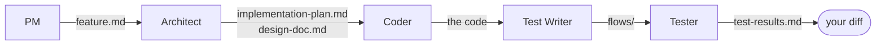
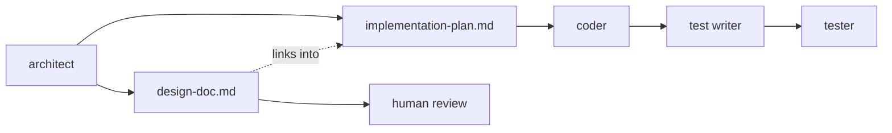
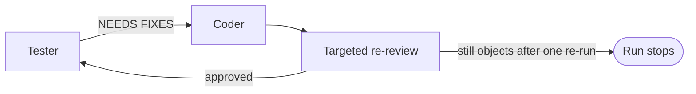
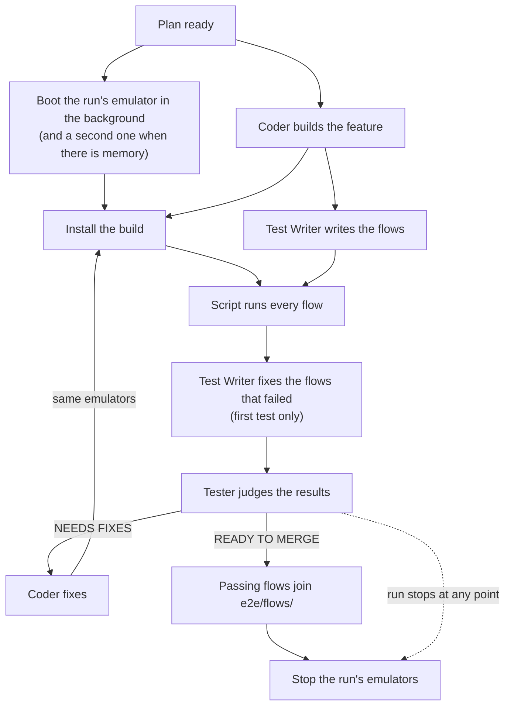
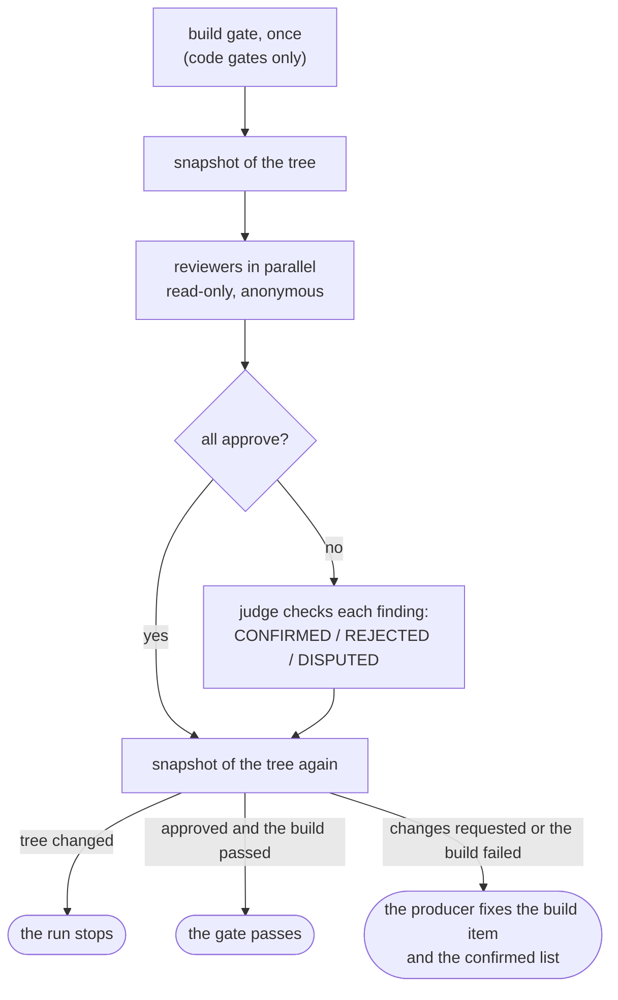

# How It Works

This document has three parts, and they are independent of each other.

**[The pipeline](#the-pipeline)** covers what happens during a run and the rules
that keep it honest. Read it to understand the product.

**[Configuration](#configuration)** covers the optional config file: the model
of each agent, other CLIs, and review panels.

**[Distribution](#distribution)** covers how one repo delivers the same agents to
three different tools, what `install.sh` creates, and how to extend it. Read it
to understand the plumbing.

## The pipeline

### The shape of a run

Every run is the same chain of handoffs. The five commands differ only in which
links are present and who approves each one.



| Command | PM | Architect | Plan review | Coder | Code review | Test Writer + Tester | Gates |
|---|:--:|:--:|:--:|:--:|:--:|:--:|---|
| `/build-guided` | yes | yes | | yes | | yes | Human, at every boundary |
| `/build-auto` | | yes | | yes | | yes | None |
| `/build-auto-reviewed` | | yes | yes | yes | yes | yes | Automated reviewers |
| `/plan-research` | yes | | | | | | Stops after the PM |
| `/plan-design` | | yes | | | | | Stops after the Architect |

The orchestrator is whatever agent your tool runs at the top level. It spawns
each specialist as a subagent, waits for that agent's DONE marker, and only then
advances.

### Phase outputs

Artifacts live in `pipeline_artifacts/{feature-slug}/`, one folder per feature,
with the slug lowercase and hyphenated (for example `background-link-checks`).

| Agent | Writes | DONE marker |
|---|---|---|
| `adt-android-pm` | `feature.md` | `✅ PM DONE` |
| `adt-android-architect` | `implementation-plan.md`, and `design-doc.md` when the command asks for one | `✅ ARCHITECT DONE` |
| `adt-android-coder` | Nothing. Only uncommitted code | `✅ CODER DONE` |
| `adt-android-test-writer` | `flows/`, one flow per test case, and `flows/INDEX.md` | `✅ TEST WRITER DONE` |
| `adt-android-tester` | `test-results.md` | `✅ TESTER DONE`, or `⛔ TESTER BLOCKED` |

The Tester is the only agent with two terminal markers, because it is the one
that has to get past whatever the device puts in front of it, and some of that
only you can open. See [When the Tester is
blocked](#when-the-tester-is-blocked).

The flow run between those two is not an agent. The orchestrator runs
`adt.sh run`, which writes `run-results.md` and `run-logs/`. After a final
`READY TO MERGE`, it also runs `adt.sh promote`, which copies the passing flows
into your project's `e2e/flows/` — the one output meant to be committed.

Reviewers write nothing at all. They are read-only by design, and each ends with
exactly one verdict marker.

| Agent | Verdicts |
|---|---|
| `adt-android-architect-reviewer` | `✅ PLAN APPROVED` or `🔧 PLAN CHANGES REQUESTED` |
| `adt-android-code-reviewer` | `✅ CODE APPROVED` or `🔧 CODE CHANGES REQUESTED` |
| `adt-android-review-judge` (review panels only) | The verdict of the gate it judges, as the last line |

A `🔧 CHANGES REQUESTED` verdict is always followed by a numbered list. The
producing agent applies every fix, since a reviewer never edits what it reviewed.

### Artifacts and their audiences

Each artifact has exactly one intended reader, and that is what shapes how it is
written.

| Artifact | Written by | Read by |
|---|---|---|
| `feature.md` | PM | The Architect, and you at the spec gate |
| `implementation-plan.md` | Architect | The Coder, both reviewers, the Test Writer, and the Tester |
| `design-doc.md` | Architect | **You.** Whoever maintains this later |
| `flows/` | Test Writer | The flow run, and the Tester when a flow fails |
| `run-results.md` | `adt.sh run` | The Tester |
| `test-results.md` | Tester | The Coder on failures, the Test Writer on flow defects, and you |



`implementation-plan.md` is a build contract: exact paths, line numbers, code,
and UI selectors. That is the right document for a Coder and the wrong one to
hand a senior engineer who has to decide whether the approach is sound. The
design doc is that second document — prose, one diagram, the alternatives that
lost, the blast radius, and the rollback story, in 1500 to 3500 words.

The Architect writes both in one phase, **the design doc first**. It has just
surveyed the codebase and weighed the alternatives at that point; a document
summarised from the plan afterwards degrades into a digest of the plan's
headings, which is the one thing it must not be.

Nothing downstream consumes the design doc. The Coder, the Tester, and the code
reviewer all keep reading the plan. The plan reviewer also reviews the design doc
when one was generated.

Which commands produce one, and how to override that per run, is in
[README.md](README.md#the-design-doc). The rules the Architect and the
orchestrator follow are in Part A of the pipeline doc, under "The Two Architect
Artifacts".

### What a run leaves behind

Artifacts land in `pipeline_artifacts/<feature-slug>/`, which is git-ignored:

```
pipeline_artifacts/recently-played-carousel/
├── feature.md              # the spec (PM phases only)
├── implementation-plan.md  # the plan, including the manual test plan
├── design-doc.md           # the same design, written for you
├── flows/                  # one test file per test case, and INDEX.md
├── run-results.md          # each flow's result and time, from the last run,
│                           #   including the regression suite's
├── run-logs/               # the driver's output for each flow
└── test-results.md         # per-case results, verdict, observations
```

Alongside that is the actual work: uncommitted changes in your working tree.
Review them, stage what you want, and commit on your own terms. When the run
ended in `READY TO MERGE`, that includes new or updated test flows in
`e2e/flows/` — your regression suite. Commit them with the feature.

### Handoff rules

**Read before write.** Every agent reads the prior phase's artifact in full
before starting. A missing required artifact is a stop condition, not something
to guess around.

**The Coder never commits.** No `git add`, no `git commit`, no staging of any
kind. Work stays uncommitted for you to review, and anything found staged is
itself a review finding.

**The plan wins.** Two documents describing one feature is one chance to
disagree, so `implementation-plan.md` stays the sole contract for
implementation. The design doc explains the change and links into the plan for
detail, and where the two differ the plan is what the Coder builds. Hand-editing
`design-doc.md` never reaches the Coder.

**Feedback lands in the documents.** Answering an approval gate with
`revise: <feedback>` re-runs the Architect, which rewrites both files in place.
Scope that is *declined* — by you withdrawing it, or by the Architect judging it
out of scope — is recorded under the design doc's **Non-Goals** with the
justification, rather than dropped. Feedback that lives only in the chat
transcript is lost the moment the run ends, and a design doc that absorbs every
request without argument is how scope creep enters.

**Artifacts stay out of git.** `pipeline_artifacts/` is ignored two redundant
ways. `install.sh` adds it to the managed `.gitignore` block, and whichever agent
first creates the directory also writes `pipeline_artifacts/.gitignore`
containing a single `*` line. The second mechanism is what covers a plugin-only
install, where no `install.sh` run ever happened. Without either one, run scratch
files would show up in the reviewer's changed-file manifest, and in the commit of
anyone who ran `git add -A` over the Coder's uncommitted tree.

### Review-driven fixes

Most of what a code reviewer finds has no fix in the plan. The plan is written
before the code exists, so it cannot name the missing null check or the
unhandled error branch a reviewer catches by reading the implementation. Read
"build exactly what the plan specifies" strictly and the gate deadlocks: the
reviewer blocks on a real defect, the Coder is forbidden to fix it, and the run
dies after three attempts having changed nothing.

So a change made to satisfy a numbered `🔧 CODE CHANGES REQUESTED` item counts
as in scope, plan or no plan, and the reviewer does not flag it as scope creep on
the next pass. Four bounds keep that narrow:

| Bound | Effect |
|---|---|
| Only what the finding names | The minimal fix, no adjacent cleanup |
| Only from a reviewer | The Coder's own initiative still stops, as before |
| No new dependencies | The plan owns the dependency set; that is still a stop |
| Correctness beats the plan, stated out loud | The Coder writes the right code and declares the departure |

The plan is never rewritten mid-run — it is the Tester's contract too. Instead
each departure is reported in the run summary, so the plan and the tree
disagreeing somewhere is something you are told rather than something you find.

This only exists where a code reviewer does, which is `/build-auto-reviewed`.
`/build-auto` and `/build-guided` are unaffected.

> **Invariant:** a genuine defect the reviewer found is fixed in the tree you are
> handed, and every place a fix departed from the plan is named in the summary.

### Review currency

A `✅ CODE APPROVED` verdict applies to the tree that existed when it was issued,
not to the feature in the abstract. Any code change after that verdict
invalidates it.

That is why the Tester's fix loop re-enters the code reviewer:



The re-review is targeted rather than a repeat of the full gate. It sees only
what changed since the last approval, plus the fix instructions the Coder worked
from, and it gets one Coder re-run. If the reviewer still objects, the run stops.
Unreviewed code is never re-tested.

> **Invariant:** the tree handed back to you passed code review after its last
> change.

Regression-suite flows in `e2e/` are the one exemption. They are test assets
rather than code, added after the final verdict, so the code reviewer leaves
them out and promoting them does not re-open a review.

Without that rule a run can reach `READY TO MERGE` carrying code no reviewer ever
read. Tests prove the feature behaves, not that the code making it behave is
sound.

### Required unit tests

Unit tests are specified by the Architect and written by the Coder. No other
agent authors them — reviewers are read-only, the Test Writer writes device
flows rather than Kotlin, and the Tester writes no tests at all.

The requirement travels in the plan. Section 1 records the project's **Test
Stack**, discovered from its version catalog and an existing test, so the Coder
uses the libraries the project already has rather than picking its own. Each
section in Section 3 then carries a **Tests required** field naming the test
file and one case per line.

Every case is phrased GIVEN / WHEN / THEN — starting state, the single action
under test, observable result — and that line becomes the test's name
unchanged, with the body repeating the three steps as commented blocks:

```kotlin
@Test
fun `GIVEN the cache holds items WHEN the refresh fails THEN the cached items are returned`() = runTest {
    // GIVEN
    val repository = NewsRepository(api = FailingApi(), cache = cache)

    // WHEN
    val result = repository.refresh()

    // THEN
    assertThat(result).isEqualTo(cachedItems)
}
```

The point is not ceremony. A case that cannot be phrased this way usually is
not a behaviour, so the format catches empty tests at planning time, before
anyone writes them. And when one fails months later, the name alone says which
behaviour broke and under what starting state.

| Field value | What the Coder does |
|---|---|
| Concrete cases | Writes exactly those, with the Test Stack's libraries |
| `None — <reason>` | Writes none, and says so in its DONE marker |
| Empty or missing | Caught by the plan reviewer as a blocker |

Both reviewers hold a side of this. The plan reviewer checks the fields were
filled in and that the cases are worth writing — a case that only asserts a
constructor assigned its arguments is flagged as fluff, and a `None` on a
ViewModel full of state transitions is a blocker. The code reviewer then checks
the tests actually exist and that each one would fail if the logic were wrong.

> **Invariant:** every unit test the plan requires exists in the tree you are
> handed, and no agent adds a testing dependency the plan did not name.

The build gate runs the project's unit-test task, but that only executes tests
that exist — it can never fail for one that was never written. That is why the
requirement lives in the plan and is checked by a reviewer instead.

**Instrumented tests.** A case that needs a real Android runtime is marked
`(instrumented)` and lives in `src/androidTest/`. JVM tests stay the default,
because they run in the build gate on every review; instrumented ones run on
the run's device as the device tests.

**Data that outlives an update.** A change to a Room schema needs its
migration, the exported schema JSON, and an instrumented migration test with
`MigrationTestHelper` that creates the old version, migrates it, and checks the
rows survive. `fallbackToDestructiveMigration` on user data is a blocker unless
the request asks for it. The same rule covers other stored formats the app
reads after an update, such as a renamed DataStore key. A missing migration
test is a blocker for both reviewers, since data loss is the one defect a user
cannot undo.

### Device tests: cases, flows and results

Every device test is written once, by one agent, at the moment it can be
written well.

| Step | Who | When | What |
|---|---|---|---|
| The case | Architect | Before the code | Steps with selectors, and an Expected result. The spec the Coder builds to |
| The flow | Test Writer | After the Coder | The same case — the Architect's steps and Expected, nothing added — as a file in the test driver's format, written from the plan and the code without running it |
| The run | `adt.sh run` | Every test and re-test | Every flow, with no model in the loop, on one emulator or two. A failure gets one retry; a pass on the retry is `FLAKY` |
| The fix | Test Writer | After the first run, only if this run's own flows failed | Each failed flow checked on the emulator once: fixed if it reached the app the wrong way, and re-run (`adt.sh run --only`); otherwise left failing, with what the screen showed |
| The verdict | Tester | After the run | Passing flows need nothing. A failing one is driven by hand to decide: the app is wrong, or the flow is |

**Every case is written so a flow can run it.** A flow can only find an
element by an exact value, act on it, and check whether something is on
screen. So the Architect writes each case to a short checklist: exact
selectors, predictable tags for items that repeat (a row's position, never a
generated id), checks that look at the whole screen, cases that stand alone
and write their preconditions as steps, and test tags exposed in bottom sheets
and dialogs as well as the main screen. The plan reviewer checks every case
against the whole list in its first round, so a case no flow could run is
fixed before any code is written. The checklist is in the pipeline doc, under
"Test Cases a Flow Can Run".

Seven rules keep it honest:

* **The Test Writer adds no tests.** It writes one flow for each case the
  Architect wrote, follows that case's steps in order, and checks only its
  Expected. It never makes up a test from the implementation or drops a case.
  It reads the new code only to learn how to reach each element — the real
  texts, test tags and screens.
* **A flow's checks come only from its case's Expected.** The Test Writer may
  add a wait or a scroll the real app needs. It never loosens a check to make it
  pass; if the app does not show what the case expects, the flow fails, and
  that is the Tester's call.
* **The plan's selectors are requirements.** A flow reaches each element with
  the selector its case names. If the Coder left out a test tag, the flow keeps
  the plan's selector and fails there, and the Tester reports it as a blocking
  finding — instead of the test quietly finding the button by its label.
* **Every check can fail.** Where a step should make something appear or go
  away, the flow first checks that it has not already happened.
* **Crashes fail tests.** After each flow, the script reads Android's crash
  log for the time the flow ran. A crash or "app not responding" of the app
  fails the flow even if every check passed, and is never retried away as
  flaky.
* **The agent that judges never writes the test.** The Tester never creates or
  edits a flow. A flow that fails while the case passes by hand is listed under
  "Flow Defects" in `test-results.md`, never sent to the Coder, and fixed by
  the Test Writer before the next re-test.
* **Every flow starts from the same device.** It first turns Airplane mode off,
  sets portrait and the light theme, then launches the installed app with clean
  data, so a flow that failed halfway cannot leave the next one offline or
  sideways.

Cases that need a credential, or whose Expected is a judgment a machine cannot
check, get no flow. The Tester drives those by hand, and `flows/INDEX.md` says
why each one has none. A case a flow can check only in part — the screen opens,
but not which field has focus — gets a *partial* flow, and the Tester checks
just the part it leaves out.

**Why it is fast.** No model works through a test step by step. The Test
Writer writes all the flows in one go, without waiting on a device; the script
runs them; and the Test Writer and the Tester only look at what failed. A flow
costs its own screen work — about 45 seconds for one that adds two items
through the UI — plus about 3 seconds of the script's time. With two
emulators, the flows run two at a time.

**The report says how sure it is.** `test-results.md` opens with "Verified V
of N plan cases; U not verified", and its Coverage table puts every case in
exactly one row: its flow passed, driven by hand, failed, or not verified with
the reason. The verdict rule is unchanged — an unverified case is not a
blocking finding — but the gap is never hidden.

### The regression suite

A run that ends in `READY TO MERGE` keeps its passing flows in the project, at
`e2e/flows/<area>/<name>.yaml`, and every later run replays part of that suite
in the same script call as its own flows.

| Rule | How it works |
|---|---|
| **What is replayed** | Every P0 flow, always, plus the tiers the plan's **Regression Scope** names per area (`--area checkout:p1,p2`) |
| **What is kept** | A flow of this run whose last result was `PASS` and whose priority is P0, P1 or P2. Not a `FLAKY` one, a failed one, or a `none` |
| **Changed behaviour** | A case whose id matches a suite flow re-specifies it: the old flow is not replayed, and the new one replaces it if kept, or the old one is removed if not |
| **Removed behaviour** | A flow listed under the plan's **Flows Retired** is not replayed, and is deleted |
| **Stale flows** | A suite flow that fails because the plan changed that behaviour on purpose (outdated), or because the flow itself is wrong, is removed instead of failing every later run |
| **Real regressions** | A suite flow that fails and whose behaviour really broke is a blocking finding. A Coder whose change cannot have caused it stops and reports it |
| **When the suite changes** | Only through `adt.sh promote`, only after a final `READY TO MERGE` |

The priorities come from the Architect, one per test case, with a reason: P0
for what makes the app unusable (keep it small, since every run replays it),
P1 for the main path of an area, P2 for edge cases. The plan reviewer checks
that a P0 is really critical and that every area the plan touches has a
Regression Scope row.

Suite flows are test assets, not code: the code reviewer leaves `e2e/` out of
its review, and promoting them does not re-open a review.

To replay the suite by hand, on an emulator of its own:

```bash
bash .claude/adt/scripts/adt.sh device-acquire --slug manual
```
```bash
bash .claude/adt/scripts/adt.sh install --slug manual -- ./gradlew installDebug
```
```bash
bash .claude/adt/scripts/adt.sh run --slug manual --driver auto-mobile --area checkout:p1,p2
```
```bash
bash .claude/adt/scripts/adt.sh device-release --slug manual
```

The results are in `pipeline_artifacts/manual/run-results.md`. Use
`--driver maestro` in a Maestro project. With the Claude Code plugin and no
per-project install, the script is in the plugin's directory, under
`scripts/adt.sh`.

### Test drivers

The Tester never talks to a device directly. It goes through a *test driver*,
an MCP server: auto-mobile by default, or Maestro when the project's
`AGENTS.md` or `CLAUDE.md` says `Test driver: maestro`. The orchestrator reads
that line once, at the start of a build command, and stops if it names anything
else.

Everything driver-specific lives in one **adapter** file per driver,
`drivers/auto-mobile.md` and `drivers/maestro.md`. The orchestrator passes the
right one to the Tester as `DRIVER_DOC`. The Tester's own prompt says how to
test; the adapter says which tool does it — how to bind to the run's device,
change device settings, tap, type and read the screen. Adding a third driver
means writing a third adapter, not editing the agents.

The Architect's test plan is the same for both: steps with test-tag selectors.
For a Compose app the Architect also makes sure the root composable sets
`testTagsAsResourceId`, because both drivers find elements by resource id.

| | auto-mobile | Maestro |
|---|---|---|
| Used when | The project declares nothing (the default) | `AGENTS.md` or `CLAUDE.md` has the line `Test driver: maestro` |
| Install | [Bun](https://bun.sh); auto-mobile itself runs through `bunx` | The [Maestro CLI](https://docs.maestro.dev), 2.11.0 or later, which needs Java 17 |
| Can't do | — | Change the font scale; such cases come back inconclusive |

auto-mobile is registered at a fixed version, with its device-setting tools
switched on. Both parts matter:

* **The tool list.** auto-mobile hides the tools that rotate the screen,
  switch dark mode, change permissions, turn on Airplane mode and run a flow
  until they are switched on. The Tester has no shell, so without them those
  test cases come back *inconclusive* instead of being worked around with
  `adb`. auto-mobile fixes the list when its background service starts, so the
  device script passes the same list on every call too.
* **The version.** `@latest` can pull a new release in the middle of a run,
  which restarts auto-mobile's shared background service under any other run
  using it. Re-check a test run after you move the pin, because tool names can
  change between releases.

### Setting up device testing

**1. Register a test driver** with your tool, under the name `auto-mobile` or
`maestro`.

| | auto-mobile | Maestro |
|---|---|---|
| Command | `bunx @kaeawc/auto-mobile@0.0.84` | `maestro mcp` |
| Environment | `AUTOMOBILE_ENABLED_TOOLS=rotate,displayConfig,setAppPermissions,setDeviceState,getDeviceState,openLink,executePlan` | — |

*Claude Code*: for auto-mobile,

```bash
claude mcp add auto-mobile -e AUTOMOBILE_ENABLED_TOOLS=rotate,displayConfig,setAppPermissions,setDeviceState,getDeviceState,openLink,executePlan -- bunx @kaeawc/auto-mobile@0.0.84
```

and for Maestro,

```bash
claude mcp add maestro -- maestro mcp
```

`add` refuses to replace an existing registration, so run
`claude mcp remove auto-mobile` first if one exists. It registers the server
for one project; add `-s user` to register it for all of them.

*OpenCode*: add the server to `opencode.json` under `mcp`. Maestro is a local
server, `{"type": "local", "command": ["maestro", "mcp"]}`. auto-mobile is
reached over HTTP, `{"type": "remote", "url": "<auto-mobile's URL>"}`, with
`AUTOMOBILE_ENABLED_TOOLS` set in the environment of whatever starts it.

*Antigravity*: add the server to its MCP configuration, `mcp_config.json`:

```json
{
  "mcpServers": {
    "auto-mobile": {
      "command": "bunx",
      "args": ["@kaeawc/auto-mobile@0.0.84"],
      "env": { "AUTOMOBILE_ENABLED_TOOLS": "rotate,displayConfig,setAppPermissions,setDeviceState,getDeviceState,openLink,executePlan" }
    }
  }
}
```

For Maestro, the entry is `"maestro": {"command": "maestro", "args": ["mcp"]}`.
A project that uses Maestro also needs the line `Test driver: maestro` in its
`AGENTS.md` or `CLAUDE.md`.

After changing auto-mobile's version or tool list, restart its background
service once, while nothing is being tested:

```bash
bunx @kaeawc/auto-mobile@0.0.84 --daemon restart
```

**2. Prepare one AVD** (recommended). auto-mobile installs a helper app on a
device the first time it drives it, and a run's read-only copy forgets it when
it stops. Open the AVD in Android Studio, ask your agent to do anything with
auto-mobile on it, close it, and set `ADT_AVD` to its name (see
[Settings](#settings)). Every run then boots a copy that already has the helper.

**3. Check your setup.** Every build command runs this check first and stops
with the fix if something is wrong; you can run it yourself at any time:

```bash
bash .claude/adt/scripts/adt.sh preflight --driver auto-mobile
```

With the Claude Code plugin and no per-project install, the script is in the
plugin's directory, under `scripts/adt.sh`.

### Devices

Each build command leases one device for its whole run, through a small script,
`adt.sh`. Normally it boots a headless, read-only copy of one of your AVDs for
that run alone, so two features in two git worktrees can be tested at the same
time.



* **One device per run, booted early.** As soon as the plan names the
  feature, the run starts booting its emulator in the background, so the boot
  overlaps the Coder's work. The first test waits for it if it is not ready
  yet; every re-test reuses it, so a fix loop never waits for a second boot. It stays up while a Coder fixes
  something, and in `/build-guided` while the run waits for you, with its
  screen kept on so it is ready when testing starts. A run that stops while
  the emulator is still booting waits for the boot, then shuts it down, so
  nothing is left running.
* **Installs land only there.** The install command runs with `ANDROID_SERIAL`
  set to the run's device.
* **The Tester uses only that device.** It receives the serial as `DEVICE`,
  binds to it in its first call, and never starts, stops or switches devices.
* **Leases are per project and feature.** A lease belongs to the project
  directory and the feature slug together, so two worktrees never share a
  device. The project directory is the one that holds `pipeline_artifacts/`,
  so an app in a subfolder of its repository works too. Leases live in
  `~/.adt/leases/`.
* **A full emulator fixes itself.** An emulator left running while the Coder
  works fills up as Google Play updates its apps. Before each install, the
  script clears app caches on an emulator it started; if the install still
  runs out of space, it restarts that emulator as a fresh copy of its AVD, on
  the same serial, and installs again. A device you attached is never cleaned
  or restarted.
* **Your emulator is never touched.** An attached device is used only when you
  set `ADT_DEVICE_MODE=reuse`, because flows clear the app's data on the device
  they run on. When no AVD can be booted (none exists, or every one is open
  normally), the preflight fails and says how to fix it; the run never falls
  back to your phone or your open emulator. The script never stops a device it
  did not start.
* **The app's own API level.** The plan's Section 0 records the app's
  `targetSdk` as its `device API`, and the run boots an AVD on that API when
  one is free. If none is, it takes the AVD with the highest API and warns, so
  create one AVD per API level you ship for. The preflight lists every AVD with
  its API. `ADT_AVD` still wins when you set it.

* **Two emulators when there is memory.** If a second emulator would still
  leave a quarter of the machine's memory free, the run boots one beside its
  own, early, and the script splits the flows between the two. Only the
  script uses it. A second emulator still booting when the flows start is
  given 90 seconds, then stopped: auto-mobile cannot drive any device while
  one is booting. `ADT_PARALLEL=1` turns this off.
* **A read-only copy.** The emulator is a read-only copy of one of your AVDs,
  so nothing a test does is saved, and it cannot start while the same AVD is
  open normally; the run picks an AVD you do not have open. Preparing one AVD
  once, with auto-mobile's helper app on it, and setting `ADT_AVD` to it, saves
  every run that install.
* **Two features at once.** Give each its own git worktree, and run
  `install.sh` once in each new worktree first: its links are kept out of
  git, so a new worktree starts without them.

### Settings

All optional. Set them in your shell profile, or for Claude Code in
`.claude/settings.json` under `env`.

| Variable | What it does |
|---|---|
| `ADT_AVD` | The AVD to boot, whatever the plan's device API. Without it, a run picks an AVD on the app's `targetSdk` |
| `ADT_DEVICE_MODE=reuse` | Use the phone or emulator already attached instead of booting one. Flows clear the app's data on it, so only use a device whose app data you can lose |
| `ADT_HEADLESS=0` | Show the emulator window, to watch a test run |
| `ADT_PARALLEL=1` | Never boot a second emulator for a run (default: one when there is memory) |
| `ADT_BOOT_TIMEOUT_S` | How long to wait for the emulator to start, in seconds (default 240) |
| `ADT_FLOW_TIMEOUT_S` | How long one flow may run before it counts as failed, in seconds (default 300) |
| `ADT_P0_BUDGET_S` | When to warn that the P0 flows are getting slow, in seconds (default 180) |

### Before a run: preflight and permissions

Each build command checks the machine before any agent runs, with
`adt.sh preflight`: `adb`, the emulator and the AVD it would boot (or the
attached device), and the test driver — for auto-mobile, that its background
service is on the pinned version or can be started; for Maestro, its version
and Java. A problem stops the run in its first minute, with the fix, instead of
at the test phase after the planning and coding are paid for. The command also
checks its own tool list for the driver's MCP tools.

So that a run is not stopped to ask permission, `install.sh` adds three rules
to the project's `.claude/settings.local.json` — the device script and the two
drivers' MCP tools — and the build commands list the same rules under
`allowed-tools`. Only a person grants these, by running `install.sh` or
`adt.sh allow`; no agent changes its own permissions. `install.sh --no-allow`
skips this, and uninstalling removes exactly the rules it added. With the
plugin and no per-project install, the preflight notices the missing rules and
prints the one command that adds them. You can run the preflight yourself at
any time: `bash .claude/adt/scripts/adt.sh preflight --driver auto-mobile`.

### Blocking findings and observations

The Tester classifies everything it finds, and only one class drives code
changes.

| | Blocking | Observation |
|---|---|---|
| **What it is** | Behaviour contradicting the request, the approved plan (including its test plan and platform notes), or the project's conventions. Also crashes, data loss, security problems, and regressions. | Anything no approved artifact asked for: UX opinions, unspecified edge cases, polish, judgment calls. |
| **What it does** | Fails its test case and drives the fix loop | Gets recorded in `test-results.md`, and nothing else |

The verdict follows mechanically. It is `NEEDS FIXES` if and only if there is at
least one blocking finding. Observations never flip the verdict and never reach
the Coder.

> **Invariant:** the Tester discovers defects. It does not create requirements.

When a behaviour genuinely should be required and no artifact requires it, that
is an observation for you to promote into a future request. In `/build-guided`
you can promote one on the spot by feeding it back through `revise:`, which makes
it a real requirement because you created it.

### When the Tester is blocked

The Tester is the one agent that can be stopped by something outside the
repository: an emulator that quietly stops accepting input, a keyguard, a login
it has no account for. It has a third verdict for exactly that, and its own
marker.

| Verdict | Marker | What it means | What happens next |
|---|---|---|---|
| `READY TO MERGE` | `✅ TESTER DONE` | Cases ran, nothing blocking | The run closes |
| `NEEDS FIXES` | `✅ TESTER DONE` | Cases ran, something blocking | The fix loop |
| `BLOCKED` | `⛔ TESTER BLOCKED` | The run could not finish | The ask goes to you |

`BLOCKED` is never `READY TO MERGE` — a case that did not run is not a case
that passed — and it does not enter the fix loop, because a fix cannot be
re-tested on a device that will not take input.

A run can find a real defect and *then* get stopped. When both rules fire,
BLOCKED wins: what has to be acted on is that the run cannot continue. The
defect is not lost — it stays in the report, the `⛔` line says how many are
waiting, and a resumed run carries them forward.

Instead the report gains a **Human Assistance Needed** section: what stopped it,
where, what it already tried, and the one thing it needs from you. The
`⛔ TESTER BLOCKED` line repeats that need in a sentence, so the orchestrator can
relay it without opening the file.

Every build command then puts that ask to you and waits. You reply `resume` —
carrying what it asked for, if it named a credential — or `stop`. There is no
`approve` at this gate, because a run that could not finish its cases is not
something to approve. Two resumes is the limit; after that it stops.

That includes `/build-auto` and `/build-auto-reviewed`. Unattended means nobody
approves the plan, the code, or the results — not that the run may never ask a
question it cannot proceed without. See [Test
credentials](#test-credentials) for why waiting beats stopping here.

> **Invariant:** a blocked run reaches you. It is never absorbed, retried
> silently, or rounded up to a pass.

### No raw adb

Neither the Tester nor the Test Writer has a shell, so neither can reach for
`adb`. That is the point. A raw `adb` command acts on the *device*, not on your
app: POWER locks the screen, HOME sends the app to the background, and every
tap after that lands on the launcher and looks exactly like a feature that does
not respond, so a run could report a pass on a feature it never saw.

Nothing a test plan asks for needs the shell:

- **Device state** (rotation, dark mode, permissions, offline, backgrounding,
  process death, force-stop) has a tool in each test driver, named in that
  driver's adapter.
- **Installing the build and reading Android's crash log** are done by
  `adt.sh`, which the build command runs, not an agent.
- **Anything the driver cannot do** makes that case *inconclusive*, with the
  reason, and it is listed as not verified. **Anything only you can open** (a
  PIN, a sign-in) makes the run `BLOCKED`, as above.

Neither is ever worked around. And whatever sent it, a tap that seemed to do
nothing is first checked against the obvious explanation: is your app still in
front?

> **Invariant:** no agent that tests or judges the app runs a shell command
> against the device.

### Test credentials

Because the pipeline drives development builds on development devices, the gates
in front of them are gates the Tester may pass — a keyguard PIN or pattern, a
device passcode, a test-account email and password, a 2FA code. It just has to be
handed the values, and only you can hand them over.

You never pass a credential on the command line. There is no `creds:` argument,
because a PIN or a password has no natural end marker the way `doc: on` does —
the command could not tell where your credential stopped and your feature
request resumed without guessing, and a wrong guess writes the PIN into
`implementation-plan.md`.

Instead the Tester asks, using the blocked path it already has:

```
⛔ TESTER BLOCKED — the emulator is locked. I need the device PIN.

you: resume: the PIN is 1234
```

It picks back up at the case it stopped on. The whole reply is the answer to
that one question, so there is nothing to parse apart.

**This works in every flow, including the auto ones.** They are unattended in
the sense that nobody approves the plan, the code, or the results — but a
blocked run is not asking for approval, it is asking for one thing it cannot
proceed without. Stopping instead would discard a finished Architect phase and
a finished Coder phase that a re-run has to pay for again. If nobody is
watching, the run waits, and nothing is lost that stopping would have saved.

Four rules keep that narrow:

- Only the Tester ever receives them. No other agent has a use for one.
- It types only what this run gave it. It does not guess a PIN, read one out of
  the repository or the environment, or reuse another app's stored session — a
  credential it was not handed is one it does not have, and that is a `BLOCKED`.
- No value reaches an artifact: not `test-results.md`, not a screenshot, not a
  recorded plan, not the final summary. Artifacts record *that* a sign-in
  happened. The value stays in the conversation.
- Test accounts only. A gate wanting a real person's account or production
  access is a `BLOCKED`, however it was supplied.

### Retry budgets

Nothing retries forever. Each budget is separate, and exhausting one stops the
pipeline with a report rather than advancing.

| Loop | Budget | On exhaustion |
|---|---|---|
| Plan review gate | 2 re-runs, so 3 attempts | Stops, reporting the gate and the unresolved feedback |
| Code review gate | 2 re-runs, so 3 attempts | Stops, reporting the same |
| Targeted re-review | 1 re-run, per fix iteration | Stops. Does not re-test, and does not spend the remaining Tester iteration |
| Tester fix loop | 2 iterations | Stops. Never declares a `NEEDS FIXES` feature complete |
| Blocked resumes (every build command) | 2 resumes | Stops. A device that will not cooperate is not fixed by more attempts |
| Cross-section check | 2 rounds | Stops, reporting the failing output and the sections involved |
| Test Writer, per failed flow | 3 runs while fixing it | Records the flow as not checked; the Tester drives that case if its flow fails |
| Flow run, per flow | 1 retry | Reports it `FAIL`; a pass on the retry is reported `FLAKY`, not a failure |

On a gate's second re-run, the producing agent receives all prior feedback from
both rounds, with previously accepted items marked resolved.

### The run ledger and resume

A build command records its run in a small ledger,
`pipeline_artifacts/.ledger/<slug>`, through `adt.sh state`: the command, the
plan and design doc paths, the test driver, the phase it is in, each Tester
verdict, and a counter for every budget in the table above. The orchestrator
bumps a counter before each re-run, and the script refuses the bump (exit 17)
once the budget is spent, so a budget holds even when the orchestrator's
context was compacted during a long run.

The ledger also makes a run resumable. If a session dies, or you stop it, start
the same command again with `resume <slug>`:

```
/build-auto-reviewed resume save-draft-on-background
```

It continues at the start of the phase it was in, with the counters it had. A
Coder phase is told that part of its work may already be in the tree; a test
phase installs the build again; a blocked Tester shows its question again. A
run that had not finished its plan has nothing to resume; start it again.

`adt.sh promote` reads the Tester's verdict itself: it keeps flows only when
`test-results.md` says `READY TO MERGE` and is newer than the last flow run.

### The changed-file manifest

Before reviewing anything, the code reviewer builds a canonical inventory of what
the run touched:

```bash
git status --porcelain
git diff
git ls-files -o --exclude-standard
```

The manifest has four parts, and all four are in scope: tracked modifications,
tracked deletions and renames, untracked new files, and anything staged (which is
a finding in itself).

The untracked part is the one that gets missed, and it is the one that matters
most in feature work. A new repository, ViewModel, and screen are all untracked
until someone commits them, and `git diff` shows nothing for any of them. A
review that reads only `git diff` can approve a feature without seeing a single
line of its implementation.

> **Invariant:** every file the run changed is in the manifest, and every file in
> the manifest is reviewed.

### Verification commands

Five named commands are the only Gradle the pipeline runs. The last two are
optional: the plan writes `none — <reason>` when they do not apply.

| Name | What it is | Who runs it |
|---|---|---|
| Build gate | The full end-of-work check | The Coder in a sequential run, before declaring done. Also the code reviewer, as part of every review |
| Cross-section check | The build gate minus the assemble task | The orchestrator, after every parallel coder group |
| Install command | Puts the build on the device | The orchestrator, through `adt.sh install`, right before every test and re-test, on the run's own device only. A failure here is a stop condition. The Tester has no shell, so it refuses to test unless the orchestrator confirms the install with a `BUILD_INSTALLED` timestamp |
| Release check | Builds the release variant with R8, when the release build is minified | The orchestrator, through `adt.sh check`, in every test. A failure is a blocking finding: a missing keep rule or a release-only compile error is found before you ship, not after |
| Device tests | The plan's instrumented tests (`src/androidTest/`), filtered to its test classes | The orchestrator, through `adt.sh check --device`, on the run's device, before the install of every test. A failure is a blocking finding. The build gate then also assembles the instrumented test APK, so the tests compile in every review |

The cross-section check still catches compile errors, because its unit-test leg
compiles the main sources.

The commands are resolved per project and never assumed. Every agent resolves
them in this order and uses the first that applies:

1. **The plan's `## 0. Verification Commands` block.** The Architect discovers the
   real commands against your project and records them there. Once a plan exists
   this is the authority, and downstream agents consume it verbatim.
2. **Your `AGENTS.md` or `CLAUDE.md`**, if it declares verification commands and no
   plan exists yet, such as when an agent is invoked standalone.
3. **The defaults**, which assume a single-module app with `lint` and `detekt`
   applied at the root:

   ```
   build gate:          ./gradlew assembleDebug lint detekt testDebugUnitTest
   cross-section check: ./gradlew lint detekt testDebugUnitTest
   install command:     ./gradlew installDebug
   release check:       none
   device tests:        none
   ```

Section 0 also records the **device API**, the app's `targetSdk`, which picks
the emulator the run boots.

The checks write `pipeline_artifacts/<slug>/checks.md`, one row per check, and
their logs to `checks/`. The Tester reads that file and reports each failed
check with the first error from its log.

Those defaults are a starting point, not a contract. `detekt` does not exist in a
project that never applied the plugin, and a multi-module project may need
`:app:assembleDebug` or `:app:lintDebug`. Naming a task the project does not
define fails the whole invocation, so a resolved command that names a missing
task is a defect in the resolution, not a broken build.

### Parallel execution

The Architect decides. Section 3 of the plan carries a **Parallel-safe** field,
and when it is YES the sections are grouped into Execution Groups.

Before spawning anything, the orchestrator runs a pre-check: extract each
section's file list and confirm no file appears in two sections of the same
group. This is a mechanical comparison rather than a judgment call. On overlap it
stops and names the overlapping files and the sections claiming them. It will not
run coders against a plan with a parallelization bug, and in `/build-guided` it
will not even ask you to approve one.

Only the orchestrator runs Gradle, because parallel coders share one working tree
and one Gradle project.

| Role | Runs Gradle? |
|---|---|
| Parallel coder | No. It implements its section, confirms nothing is staged, and declares done |
| Sequential coder (`Parallel-safe: NO`, a reviewer-driven fix, or a Tester-driven fix) | Yes, the build gate. It is the only agent touching the tree, so the result means something |
| Orchestrator | Yes, the cross-section check, after every group |

This is not a style preference. Concurrent Gradle invocations against one project
directory contend on the locks under `.gradle/` and write to the same `build/`
outputs, which produces lock timeouts and non-deterministic failures. Each
coder's build would also be compiling files its siblings are still editing, so a
failure would say nothing about the coder that ran it.

That is why the cross-section check runs after every group, including a group
with only one section. Parallel coders run no Gradle at all, so a skipped check
means that group's work was verified by nothing.

### When the cross-section check fails

A failure here is in scope for the run, since catching it is what the check
exists for. The orchestrator resolves it rather than reporting and stopping:

1. Attribute each failure to the section that owns the file, using the plan's
   per-section file lists. A failing unit test is attributed the same way, by
   the section whose file list holds that test file.
2. Re-spawn the owning coder, one at a time and never concurrently. A sequential
   fix coder does run the build gate.
3. Re-run the check. Allow at most 2 rounds, then stop.
4. If a failure cannot be attributed to a single section, because it is a genuine
   integration defect or two sections' public interfaces contradict each other,
   stop and report it as a plan defect. Do not guess which coder should absorb
   it.

### Model selection

Each agent file records a recommended model: `opus` for the PM, the Architect,
and both reviewers, and `sonnet` for the Coder, the Test Writer and the
Tester. The review judge uses the main model.

Claude Code honours those per agent, and the `agents:` part of
`.agentic-dev-team/config.yaml` overrides them per role, in every command (see
[Models: `agents:`](#models-agents)). The orchestrator passes the configured
alias in the Agent tool's `model` parameter. With no configured value it
passes nothing, so the agent file applies. Antigravity and OpenCode do not
support per-subagent model selection, so every subagent inherits your globally
selected model, and they ignore `agents:`. Select the strongest model
available before a full pipeline run in those tools, or, in
`/build-auto-reviewed`, run a role through an external CLI (see
[Other CLIs and review panels](#other-clis-and-review-panels-build_auto_reviewed)).

## Safeguards

What the pipeline guarantees, each explained in full in its own section.

### Testing cannot invent requirements

The Tester only sends work back for *blocking* findings: behaviour that
contradicts your request, the approved plan, or your project's conventions, plus
crashes, data loss, and regressions. Anything else it notices, such as a UX
opinion or an unspecified edge case, is recorded as an *observation* in
`test-results.md` for you to decide on. QA finds defects. It does not get to add
scope mid-run. See [Blocking findings and observations](#blocking-findings-and-observations).

### A test that could not run never counts as a pass

When the device stops the Tester — a locked screen, a sign-in it has no
account for, an emulator that stops responding — it stops with `BLOCKED` and
asks you for the one thing it needs, such as the device PIN. Reply
`resume: the PIN is 1234` and it carries on; it never writes the value down. A
blocked run is never reported as `READY TO MERGE`, and the Tester never works
around a problem with the shell.
[When the Tester is blocked](#when-the-tester-is-blocked) has the details.

### Unit tests are specified, not left to chance

The Architect names the unit tests each section needs, using the libraries your
project already uses — discovered from your version catalog, not chosen from a
default list. Every case is phrased GIVEN / WHEN / THEN, and that line becomes
the test's name and the shape of its body, so a failing test says which
behaviour broke without anyone opening the file. The Coder writes exactly
those, and both reviewers check them:
the plan reviewer that the cases are worth writing, the code reviewer that they
exist and would fail if the logic were wrong. A section with no logic worth
testing says so explicitly rather than padding itself with tests that cannot
fail. See [Required unit tests](#required-unit-tests).

### Reviews cover the final code

An approval applies to the tree that existed when it was issued. When the Tester
finds a defect and the Coder patches it, a targeted re-review of that patch runs
before the re-test. The tree you are handed has passed review after its last
change, not before it. See [Review currency](#review-currency).

### Build commands are discovered, not assumed

The Architect resolves your project's real build, lint, test, and install
commands against your Gradle setup and records them in the plan. A project
without `detekt`, or one that needs `:app:lintDebug` and a `demoDebug` variant,
runs its own commands instead of failing on tasks it never defined. See [Verification commands](#verification-commands).

### Parallel work is checked before it starts

When the Architect marks sections parallel-safe, the orchestrator verifies
mechanically that no file is claimed by two sections in the same group before
spawning anyone, then verifies the result again after every group. See [Parallel execution](#parallel-execution).

### The installer never overwrites anything

`install.sh` only creates symlinks for files this repo owns. If something of
yours already sits at one of those paths, it refuses and names the path. The
one file it edits, `.claude/settings.local.json`, gets only the pipeline's
three permission rules added; every other setting stays as it was, a file that
is not valid JSON is left alone, and uninstalling removes only those rules. See [Refusal behavior](#refusal-behavior).

## Configuration

Every setting is optional. **Until you edit the config file, every command
works exactly as it does without it.**

### The config file

`.agentic-dev-team/config.yaml`, in your project root. It is created for you,
with every setting commented out, by `install.sh` or by the first command you
run in a project with the plugin install. It is never overwritten after that.
Next to it, `.agentic-dev-team/.gitignore` (one line: `*`) keeps the folder
out of git.

To share the config with your team, delete `.agentic-dev-team/.gitignore` and
commit `config.yaml`. The installer and the commands never re-create that
`.gitignore` while `config.yaml` exists. **Warning:** when a teammate pulls
the committed file, git silently replaces their own local, ignored
`config.yaml`. Ask the team to copy any local settings first.

The template is `plugins/agentic-dev-team/config.example.yaml`. At the start
of every command, before the first agent runs, the orchestrator validates the
whole file, stops with a message that names the key if something is wrong,
and sets two switches:

| Switch | On when | Effect |
|---|---|---|
| `MODELS` | A model is set for a role the command starts | Claude Code passes that model when it starts the agent |
| `RUNS` | `/build-auto-reviewed` only: a role uses a `runner` other than `native`, or a gate lists 2 or more reviewers | The phases run as `AGENTIC_DEV_TEAM_CONFIG.md`, "Configured Runs", says |

With both switches off, a command runs exactly as it would without the file.

### Models: `agents:`

The model of each agent, in every command.

```yaml
agents:
  pm:    { model: opus }
  coder: { model: opus }
```

Roles: `pm`, `architect`, `architect_reviewer`, `coder`, `code_reviewer`,
`test_writer`, `tester`, `review_judge`. Without a value, the model in the
agent file applies (`opus` for the PM, the Architect and both reviewers,
`sonnet` for the Coder, the Test Writer and the Tester, the main model for the
judge).

In Claude Code the value is a model alias: `opus`, `sonnet`, `haiku` or
`fable`. What an alias runs:

| Your main session | Config | The agent runs |
|---|---|---|
| Same family (for example Opus, config `opus`) | `opus` | Exactly your main session's model, including a 1M-context variant |
| Other family (for example Sonnet, config `opus`) | `opus` | The version the alias maps to (Opus 5.5 on the Anthropic API today), or the model in `ANTHROPIC_DEFAULT_OPUS_MODEL` when you set it |

You cannot pin an exact version for an agent that runs inside your tool. To
pin one, use `runner: claude` with a full model ID in `/build-auto-reviewed`
(below), set `ANTHROPIC_DEFAULT_<FAMILY>_MODEL` in the `env` of
`.claude/settings.json` for another family, or select that version as your
main model. When `CLAUDE_CODE_SUBAGENT_MODEL_FORCE` is set, Claude Code ignores
these settings, and the run summary says so. When `CLAUDE_CODE_SUBAGENT_MODEL`
is set, model settings need Claude Code v2.1.251 or later.

Antigravity and OpenCode run every subagent on the model you selected in the
tool, so they ignore `agents:`. The run summary says so.

### Other CLIs and review panels: `build_auto_reviewed:`

For `/build-auto-reviewed` only.

```yaml
build_auto_reviewed:
  code_reviewer:
    reviewers:
      - { runner: native }
      - { runner: codex, required: false }
      - { runner: claude, model: claude-opus-5-5 }
```

Each role (`architect`, `coder`, `tester`, and each reviewer) can run in a
different tool, through that tool's CLI and **your own login** (no API key):

| `runner` | Runs |
|---|---|
| `native` (default) | Inside the tool you run the command in |
| `claude` | `claude -p` (Claude Code CLI) |
| `codex` | `codex exec` (OpenAI Codex CLI) |
| `agy` | `agy -p` (Antigravity CLI) |
| `opencode` | `opencode run` (OpenCode CLI) |
| `command` | Any CLI, from a template such as `gemini -p {instruction} -m {model}`, with `check: gemini` |

Other keys: `model` (passed to the CLI's `--model`), `timeout_minutes`
(default 30 for a reviewer, 120 for the others), and `required` (reviewers
only; `false` lets the run continue without that reviewer). Each CLI must be
installed and logged in; the run checks this before it starts. The Test Writer
and the device steps of the test phase always run in your current tool.

An external role runs through `scripts/adt-run-agent.sh`, which writes a
prompt file, starts the CLI detached in its own process group, enforces the
timeout, and reports a result with the agent's verdict marker. The run files
are in `pipeline_artifacts/.runs/`.

### How a review panel runs

With 2 to 5 reviewers for a gate, the gate becomes a panel. The orchestrator
runs the build gate once, the reviewers review the same tree in parallel and
anonymously (as A, B, C, in a new random order each round), and the
`adt-android-review-judge` agent checks every finding against the code,
merges duplicates, and gives the verdict. When every reviewer approves, the
judge does not run. The judge always runs in your current tool, on your main
model unless `agents.review_judge` sets one. A failed build never passes a
gate.



A gate that is not configured has one native reviewer. The retry budgets are
the same for a panel: a panel round counts as one review.

### Things to know

* **Cost.** Each panel round is one agent run per reviewer, plus the judge.
* **Read-only is enforced by a check, not by every CLI.** `claude` and
  `codex` reviewers run in a read-only mode; `agy` and `opencode` have none.
  The orchestrator hashes the working tree before and after each review round,
  and stops the run if anything changed. It does not revert anything. Keep
  Gradle's `build/` folders git-ignored, as a normal Android project does.
* **Codex as Coder or Tester.** Codex's sandbox blocks network access and
  writes outside the project by default, so Gradle and `adb` can fail. Use
  another runner for those roles, or allow them in your Codex configuration.
* **An external Tester** needs the test driver's MCP server (auto-mobile or
  Maestro) in that CLI's own config. It never receives a device PIN: after you
  answer a blocked Tester with anything other than `resume` or `stop`, the
  Tester runs inside your tool for the rest of the run.
* **A `command` template is not run by a shell.** Do not use `'`, `\`,
  backticks, `$`, `|`, `;`, `&`, `<` or `>` in it. Do not pass a placeholder to
  a program that runs its arguments as code (such as `python3 -c`).
* **An interrupted run.** External agents run as separate processes. If you
  stop a run in a way the orchestrator cannot handle (for example Esc), run
  the `--cancel` command that every run summary prints.
* **CLI flags change.** All runner flags are in
  `plugins/agentic-dev-team/scripts/adt-run-agent.sh`.

## Distribution

### How the three tools find the files

This repo is a shared configuration package rather than a library you import.
Each Android project that wants the pipeline links this repo's files into its own
`.claude/`, `.agents/`, and `.opencode/`. Six mechanics make that work.

1. **Per-file symlinks, never per-directory.** Your `.claude/`, `.agents/`, and
   `.opencode/` stay real directories. You can keep adding your own commands and
   agents alongside ours, and they coexist freely.
2. **Claude Code discovery.** Claude Code scans `.claude/commands/` and
   `.claude/agents/` by filename. Our symlinks sit at those canonical paths, so
   all five commands and all eight `@adt-*` agents are available automatically.
3. **Antigravity discovery.** Antigravity scans `.agents/workflows/` for slash
   commands and auto-loads `.agents/agents.md` into the system prompt as
   user_rules. `install.sh` inlines the persona stubs from this repo's
   `.agents/AGENTIC_DEV_TEAM.md` into a marker-fenced block in your `agents.md`,
   so Antigravity sees them in context without loading another file. The
   HTML-comment markers are ignored by Antigravity itself.
4. **OpenCode discovery.** OpenCode scans `.opencode/commands/` for slash commands
   and `.opencode/agents/` for subagents. Each agent file is a `mode: subagent`
   stub whose body reads its canonical prompt from `.claude/agents/adt-*.md`, so
   the orchestrator can delegate to `@adt-android-architect` and the rest with an
   identical persona. No `agents.md` inlining is needed, because the per-file
   definitions are the discovery mechanism.
5. **One source of truth across all three.** Every tool ends up reading the same
   agent prompts and the same pipeline docs (`AGENTIC_DEV_TEAM_*.md`). Edit those in the
   clone and every consuming project picks the change up on the next file read,
   with no re-install required for in-place edits.
6. **A managed `.gitignore` block.** Symlink targets are per-developer absolute
   paths such as `~/code/agentic-dev-team/...`, which would not resolve on a
   teammate's machine, so `install.sh` maintains a small block listing them.

### What install.sh creates

For every file this repo owns, `install.sh` creates a symlink at the matching
path inside your project.

| Project path | Symlink target in your clone |
|---|---|
| `.claude/commands/build-guided.md` | `<clone>/.claude/commands/build-guided.md` |
| `.claude/commands/build-auto.md` | `<clone>/.claude/commands/build-auto.md` |
| `.claude/commands/build-auto-reviewed.md` | `<clone>/.claude/commands/build-auto-reviewed.md` |
| `.claude/commands/plan-research.md` | `<clone>/.claude/commands/plan-research.md` |
| `.claude/commands/plan-design.md` | `<clone>/.claude/commands/plan-design.md` |
| `.claude/agents/adt-android-pm.md` | `<clone>/.claude/agents/adt-android-pm.md` |
| `.claude/agents/adt-android-architect.md` | `<clone>/.claude/agents/adt-android-architect.md` |
| `.claude/agents/adt-android-architect-reviewer.md` | `<clone>/.claude/agents/adt-android-architect-reviewer.md` |
| `.claude/agents/adt-android-coder.md` | `<clone>/.claude/agents/adt-android-coder.md` |
| `.claude/agents/adt-android-code-reviewer.md` | `<clone>/.claude/agents/adt-android-code-reviewer.md` |
| `.claude/agents/adt-android-test-writer.md` | `<clone>/.claude/agents/adt-android-test-writer.md` |
| `.claude/agents/adt-android-tester.md` | `<clone>/.claude/agents/adt-android-tester.md` |
| `.claude/agents/adt-android-review-judge.md` | `<clone>/.claude/agents/adt-android-review-judge.md` |
| `.claude/AGENTIC_DEV_TEAM_PIPELINE.md` | `<clone>/.claude/AGENTIC_DEV_TEAM_PIPELINE.md` |
| `.claude/AGENTIC_DEV_TEAM_ORCHESTRATION.md` | `<clone>/.claude/AGENTIC_DEV_TEAM_ORCHESTRATION.md` |
| `.claude/AGENTIC_DEV_TEAM_CONFIG.md` | `<clone>/.claude/AGENTIC_DEV_TEAM_CONFIG.md` |
| `.claude/adt/scripts/adt.sh` | `<clone>/.claude/adt/scripts/adt.sh` |
| `.claude/adt/scripts/adt-run-agent.sh` | `<clone>/.claude/adt/scripts/adt-run-agent.sh` |
| `.claude/adt/drivers/auto-mobile.md` | `<clone>/.claude/adt/drivers/auto-mobile.md` |
| `.claude/adt/drivers/maestro.md` | `<clone>/.claude/adt/drivers/maestro.md` |
| `.agents/workflows/build-guided.md` | `<clone>/.agents/workflows/build-guided.md` |
| `.agents/workflows/build-auto.md` | `<clone>/.agents/workflows/build-auto.md` |
| `.agents/workflows/build-auto-reviewed.md` | `<clone>/.agents/workflows/build-auto-reviewed.md` |
| `.agents/workflows/plan-research.md` | `<clone>/.agents/workflows/plan-research.md` |
| `.agents/workflows/plan-design.md` | `<clone>/.agents/workflows/plan-design.md` |
| `.opencode/commands/build-guided.md` | `<clone>/.opencode/commands/build-guided.md` |
| `.opencode/commands/build-auto.md` | `<clone>/.opencode/commands/build-auto.md` |
| `.opencode/commands/build-auto-reviewed.md` | `<clone>/.opencode/commands/build-auto-reviewed.md` |
| `.opencode/commands/plan-research.md` | `<clone>/.opencode/commands/plan-research.md` |
| `.opencode/commands/plan-design.md` | `<clone>/.opencode/commands/plan-design.md` |
| `.opencode/agents/adt-android-pm.md` | `<clone>/.opencode/agents/adt-android-pm.md` |
| `.opencode/agents/adt-android-architect.md` | `<clone>/.opencode/agents/adt-android-architect.md` |
| `.opencode/agents/adt-android-architect-reviewer.md` | `<clone>/.opencode/agents/adt-android-architect-reviewer.md` |
| `.opencode/agents/adt-android-coder.md` | `<clone>/.opencode/agents/adt-android-coder.md` |
| `.opencode/agents/adt-android-code-reviewer.md` | `<clone>/.opencode/agents/adt-android-code-reviewer.md` |
| `.opencode/agents/adt-android-test-writer.md` | `<clone>/.opencode/agents/adt-android-test-writer.md` |
| `.opencode/agents/adt-android-tester.md` | `<clone>/.opencode/agents/adt-android-tester.md` |
| `.opencode/agents/adt-android-review-judge.md` | `<clone>/.opencode/agents/adt-android-review-judge.md` |

The canonical pipeline docs (`AGENTIC_DEV_TEAM_PIPELINE.md`,
`AGENTIC_DEV_TEAM_ORCHESTRATION.md` and `AGENTIC_DEV_TEAM_CONFIG.md`),
`scripts/` and `drivers/` live in `plugins/agentic-dev-team/` so the Claude
Code plugin can package them; the clone's `.claude/adt/scripts` and
`.claude/adt/drivers` are symlinks to those directories, and the clone's
`.claude/AGENTIC_DEV_TEAM_*.md` are symlinks to the docs. A project installed
before a doc was added gets its link at the next `install.sh` run; until then,
the commands stop and say so.

Three further changes happen outside symlinks: two marker-fenced managed
blocks, and three permission rules.

**`.gitignore`** gains a block listing the symlink paths above, plus
`/pipeline_artifacts/`. This block only exists on the `install.sh` path. See
"Handoff rules" above for what covers a plugin-only install.

**`.agents/agents.md`** gains a block containing the inlined persona stubs from
this repo's `.agents/AGENTIC_DEV_TEAM.md`. The file is created if it does not
exist, and your content outside the markers is left untouched.

**`.claude/settings.local.json`** gains three permission rules, so Claude Code
does not stop a run to ask: `Bash(bash .claude/adt/scripts/adt.sh *)`,
`mcp__auto-mobile__*` and `mcp__maestro__*`. Every other setting in the file
stays as it was, a file that is not valid JSON is left alone, and a rule you
already had is not counted as ours. If the file is new, it is kept out of git
through `.git/info/exclude`, not your `.gitignore`. `install.sh --uninstall`
removes exactly the rules it added; `install.sh --no-allow` skips this step.

**`.agentic-dev-team/`** gets `config.yaml` (a copy of
`plugins/agentic-dev-team/config.example.yaml`) and a `.gitignore` with `*`,
only when `config.yaml` does not exist yet. `install.sh` never edits or deletes
anything in that folder, not even on `--uninstall`. With the plugin install,
the first command you run creates the same two files.

After install, `ls -la .claude/commands/` makes ownership obvious. Our entries
show an arrow pointing into the clone, and yours do not.

### Refusal behavior

If a real file, or a symlink that is not ours, already sits at one of our
destinations, `install.sh` refuses with the path and a "rename or delete, then
re-run" message. Nothing is ever overwritten silently. Collision checks run
pre-flight, before any symlink is created, so a refusal leaves the install in a
clean state.

### Extending the pipeline

This section is for maintainers and contributors.

**Adding an agent.** Create `.claude/agents/adt-<name>.md`, always with the
`adt-` prefix so it never collides with a developer's own agents. Add a short
stub to `.agents/AGENTIC_DEV_TEAM.md` using the `@adt-<name>` handle and
referencing the new prompt, for Antigravity. Create
`.opencode/agents/adt-<name>.md` as a `mode: subagent` stub whose body reads the
canonical prompt, for OpenCode. On the next `install.sh` run in each project,
`@adt-<name>` becomes invocable in all three tools and the `agents.md` block
updates itself.

**Adding a command.** Create `.claude/commands/<name>.md` with the orchestration
prompt, then create `.agents/workflows/<name>.md` and
`.opencode/commands/<name>.md` as symlinks to `../../.claude/commands/<name>.md`.
`/build-auto-reviewed` was built exactly this way. Its workflow symlinks point at
the command, which orchestrates the two reviewers between the existing phases.

**Changing shared orchestration rules.** Edit the canonical
pipeline docs in `plugins/agentic-dev-team/`. Agent prompts and commands
reference them by path and the project copies are symlinks, so edits propagate
the next time an agent reads the file, with no install needed. Agent-facing
rules go in `AGENTIC_DEV_TEAM_PIPELINE.md` (Part A), which every agent reads.
Orchestrator-only rules go in `AGENTIC_DEV_TEAM_ORCHESTRATION.md` (Part B), and
the config file's rules in `AGENTIC_DEV_TEAM_CONFIG.md`. Agents never read
those two, so a rule there costs agents nothing.

**Removing or renaming files.** Just do it in the repo. The sync logic in
`install.sh` removes stale symlinks from consuming projects on the next run.

### Project context

Every `adt-*` agent reads your project's `AGENTS.md` or `CLAUDE.md`, whichever
exists, for stack, architecture, conventions, and verification rules. You do not
need to document the pipeline itself in there, because the agents bring their own
instructions. What they need from you is what makes your codebase specific.

### Troubleshooting

**install.sh refused with "real file at X".** You have your own file at one of our
install paths. Rename or delete one side, then re-run.

**I pulled the repo but new commands are not showing up**, or a command stops
and says the installed files are older than the command. Run `install.sh` in the
project again. `git pull` refreshes files that are already symlinked, but it
cannot materialize symlinks for newly added ones.

**There is a broken symlink in `.claude/agents/`.** A file was probably renamed or
removed upstream. Run `install.sh` and the sync will clear stale symlinks.

**An agent's persona looks out of date in Antigravity.** Persona stubs are inlined
into `.agents/agents.md` at install time rather than symlinked, so re-run
`install.sh` to refresh that block. Agent prompts and the pipeline doc are
symlinked and never need this.

**Both `AGENTS.md` and `CLAUDE.md` exist.** Agents read whichever they find first.
Pick one as canonical and keep them in sync, or delete one.

**The Tester stops saying its driver's tools are missing.** The test driver's
MCP server is not registered with your tool, or not under the expected name.
auto-mobile must be registered as `auto-mobile` and Maestro as `maestro`; the
[Setting up device testing](#setting-up-device-testing)
has the commands. In OpenCode both belong in `opencode.json` under the `mcp` key.

**The run stopped at the start, naming the test driver.** Your `AGENTS.md` or
`CLAUDE.md` has a `Test driver:` line with a value other than `auto-mobile` or
`maestro`. Fix the line, or delete it to use auto-mobile.

**Rotation, dark mode, permission or offline cases come back inconclusive.** The
Tester has no shell, so it only uses the test driver's own tools. Under
auto-mobile, the ones that change device settings are hidden until they are
switched on: check the `AUTOMOBILE_ENABLED_TOOLS` value and the pinned version
from [Setting up device testing](#setting-up-device-testing),
then restart auto-mobile's background service once
(`bunx @kaeawc/auto-mobile@0.0.84 --daemon restart`) and start a new session.
Under Maestro, font-scale cases are always inconclusive, because Maestro cannot
change the font scale.

**The install failed for lack of space, even on a fresh copy.** The AVD the
run boots is itself nearly full; every run's emulator starts from its saved
state. Give it more room in Android Studio's Device Manager: edit the AVD, set
Internal storage higher (16 GB, say), then Wipe Data on it. Or set `ADT_AVD`
to an AVD with more room.

**The Tester stopped saying the build was not installed.** It only tests a build
the orchestrator has just installed, which the orchestrator confirms with a
`BUILD_INSTALLED` line. When you call the Tester yourself, outside a build
command, install the build first and pass that line with the plan path.

**"No usable AVD", or the run took my attached phone.** Testing needs an AVD
it can boot read-only, and a read-only copy cannot start while the same AVD is
open normally. Create a second AVD in Android Studio's Device Manager, or close
the one you have open, or set `ADT_AVD` to an AVD you do not use day to day.

**An emulator was left running.** A session that dies mid-run leaves its
emulator up. Running the same command again for the same feature picks it back
up. The pre-run check warns about any that has been running for more than
three hours, with the command that stops it. To stop one yourself, list the
leases and release the one you want:

```bash
bash .claude/adt/scripts/adt.sh device-list
bash .claude/adt/scripts/adt.sh device-release --serial emulator-5556
```

With the Claude Code plugin and no per-project install, the script is in the
plugin's directory instead, under `scripts/adt.sh`.

**A flow fails, but the Tester says the case passes by hand.** The flow
expressed a step or a wait wrongly, not the app. The Tester lists it under
"Flow Defects", and the Test Writer rewrites it before the next re-test. If no
re-test happens, the run is still judged by the Tester's hand check, and the
flow is left as it was.

**The same suite flow fails on every run.** It is broken independently of the
features being built — the Coder stops rather than "fixing" unrelated code.
Fix the flow by hand, or delete it from `e2e/flows/`; a later feature that
covers the same area can write it again.

**The run stopped at the start, at the preflight.** Each `FAIL` line says what
to fix. Run the same check yourself until it passes:
`bash .claude/adt/scripts/adt.sh preflight --driver auto-mobile` (or
`--driver maestro`).

**auto-mobile's background service cannot start: "Database startup migrations
failed".** Its own database, `~/.auto-mobile/auto-mobile.db`, was left by an
older version in a state the pinned version cannot upgrade. Move it aside,
keeping it as a backup, and auto-mobile creates a fresh one:

```bash
mv ~/.auto-mobile/auto-mobile.db ~/.auto-mobile/auto-mobile.db.bak
```

**Claude Code still asks for permission during a run.** Re-run `install.sh` in
the project, or `bash .claude/adt/scripts/adt.sh allow`, then start a new
session. A rule only matches the script run as one plain command,
`bash .claude/adt/scripts/adt.sh …`, which is how the commands run it.

**The flow run fails with "Timed out waiting for concurrent daemon restart".**
An older auto-mobile background service is still running, and the pinned
version cannot take over from it. The preflight normally catches this before a
run starts. Restart it on the pinned version:

```bash
bunx @kaeawc/auto-mobile@0.0.84 --daemon restart
```

If that refuses with "could not verify the live PID", the old service predates
the pinned version's restart protocol. Find it and stop it by hand, then start
a new session:

```bash
ps aux | grep 'auto-mobile.*--daemon-mode'
kill <pid>
```

**A run stopped mid-pipeline.** That is the intended behaviour. Every loop is
bounded, as described under "Retry budgets", and a stop reports the gate, the
unresolved feedback, and the current state of the artifacts and diff. The work so
far is still in `pipeline_artifacts/` and in your working tree.
