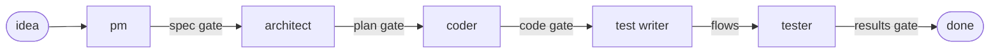
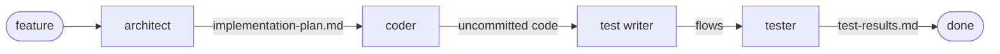
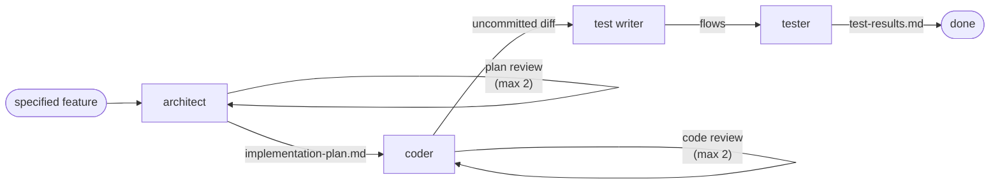

# Agentic Android Dev Team

Seven specialist AI agents that work like an Android team. You describe a
feature in your editor's chat prompt, and they pass it down the line: product
spec, implementation plan, code, then testing on a real device. What comes back
is an uncommitted diff and a test report.

Works the same way in [Claude Code](https://claude.com/claude-code),
[Antigravity](https://antigravity.google), and [OpenCode](https://opencode.ai).

## How a run works

Every run is the same chain of handoffs. Each agent reads the previous agent's
output in full before it starts, so the spec constrains the plan, the plan
constrains the code, and the plan's test cases are what actually gets tested.


You decide how much of that chain runs and who approves each step. One command
starts from a vague idea and pauses for your sign-off at every boundary, another
runs start to finish unattended, and a third puts an automated reviewer between
the phases. Two more run a single phase and stop.

Written artifacts land in a git-ignored folder for the feature. The code itself
stays uncommitted in your working tree, so you review it and commit on your own
terms.

## Why it is split up this way

A single agent asked to "build this feature" will plan it, write it, and grade
its own work in one pass. This project splits that job across agents with
separate mandates, and puts a reviewer between them.

* The Architect reads your codebase and writes the plan before any code exists.
  It names exact files and line numbers, and records the manual test plan up
  front.
* In guided and plan commands, what you review is a design document, not a diff.
  Deciding an approach is wrong is cheapest before the code exists, and a diff is
  the most expensive place to discover it.
* In the reviewed flow, code review always covers the final state of the tree,
  including fixes made after testing.
* Device tests are planned before the code and written after it. The
  Architect decides what to test; once the feature exists, the Test Writer
  turns each test case into a file that runs in seconds; the Tester judges the
  results on a real emulator, not a mocked harness. No agent grades its own
  work.
* Retry loops are bounded. Reviewers get at most two rounds, the fix loop gets at
  most two, and a run that still fails stops and explains why instead of
  reporting success.
* Nothing is committed for you.

## The agents

| Agent | Role | Output |
|---|---|---|
| `adt-android-pm` | Principal Product Manager | `feature.md`, an unambiguous spec |
| `adt-android-architect` | Staff+ Android engineer | `implementation-plan.md`, with exact file changes and a manual test plan, plus `design-doc.md` for human review |
| `adt-android-architect-reviewer` | Plan reviewer, read-only | Approval, or a numbered list of required changes |
| `adt-android-coder` | Implementer | Uncommitted code in your working tree |
| `adt-android-code-reviewer` | Code reviewer, read-only | Approval, or a numbered list of required changes |
| `adt-android-test-writer` | Test engineer | One runnable *flow* file per test case, written against the running app |
| `adt-android-tester` | Principal QA engineer | `test-results.md`, with a verdict from a real device |

Each agent reads your project's `AGENTS.md` (or `CLAUDE.md`) for stack,
architecture, and conventions, so the output matches your codebase rather than a
generic Android one.

## Commands

Five slash commands. Three run the full pipeline, two stop after a single phase.

| Command | Phases | Who approves | Use it for |
|---|---|---|---|
| `/build-guided` | PM, Architect, Coder, Test Writer, Tester | You, at every phase boundary | A rough idea you want shaped before code exists |
| `/build-auto` | Architect, Coder, Test Writer, Tester | Nobody, it runs start to finish | A feature you have already specified precisely |
| `/build-auto-reviewed` | Architect, Coder, Test Writer, Tester, plus a reviewer after the Architect and the Coder | Reviewer agents, with no human pause | An unattended run you want to trust. Costs more tokens |
| `/plan-research` | PM only | n/a | Turning a vague idea into a spec and nothing more |
| `/plan-design` | Architect only | n/a | Auto-detects input: produces whichever of the plan and design doc is missing |

The two single-phase commands write their artifact and stop. Their output feeds
straight into a `build-*` command later, or into each other.

### /build-guided

```
/build-guided add a recently-played carousel to the home screen
```

The PM asks clarifying questions, writes a spec, and pauses. At each boundary you
reply `approve`, `revise: <feedback>`, or `stop`. Before the Coder runs, you also
see whether the Architect judged the work parallel-safe and how many coder agents
that implies. Reply `force-sequential` to override it and spend fewer tokens.



The plan gate shows you the design doc rather than a dump of plan headings, so
the decision is made at design altitude while changing course is still cheap.
Feedback you give there is rewritten into both documents, including scope you
decline, which is recorded under **Non-Goals** with your reason rather than
dropped.

### /build-auto

```
/build-auto add a "save draft on background" hook to ComposeViewModel that
            persists the current input to Room every 2s and restores it on launch
```

No PM phase and no pauses. If the request turns out to be too vague for the
Architect to plan concretely, the run stops and points you at `/build-guided`.
This is the speed path, so it writes no design doc by default. Pass `doc: on` if
you want one.



### /build-auto-reviewed

```
/build-auto-reviewed add a "save draft on background" hook to ComposeViewModel
                     that persists input to Room every 2s and restores on launch
```

Same shape as `/build-auto`, with an automated reviewer after each producing
phase. The plan reviewer checks the plan against the codebase, Section 0 verification
tasks, and pattern-fit. The code reviewer reads the full set of changes, which includes
every new untracked file, not just what shows up in `git diff`.

When a reviewer requests changes, the producing agent re-runs with that feedback,
at most twice per gate. If the reviewer is still unsatisfied after the second
re-run, the pipeline stops and reports instead of shipping rejected work.



### /plan-research and /plan-design

```
/plan-research add a recently-played carousel to the home screen
/plan-design   pipeline_artifacts/recently-played-carousel/feature.md
/plan-design   pipeline_artifacts/recently-played-carousel/implementation-plan.md
/plan-design   pipeline_artifacts/recently-played-carousel/design-doc.md
```

/plan-research runs the PM alone. `/plan-design` runs the Architect alone. Use
them to think a feature through, or to size the work, without committing to a
build. `/plan-design` produces both of the Architect's files by default, but if
you give it an existing plan or design doc, it writes only the missing one.

`/plan-design` auto-detects what it receives. Hand it an existing
`implementation-plan.md` and it writes the design doc without re-planning. Hand
it an existing `design-doc.md` and it writes the plan without touching the doc.

### The design doc

The Architect writes `implementation-plan.md` (the build contract for agents) and
can also emit `design-doc.md` (for human review). Depending on the command used,
it produces or skips the design doc:

| Command | Design doc | Where you read it |
|---|---|---|
| `/plan-design` | auto-detected | printed to chat upon completion |
| `/build-guided` | on | at the plan approval gate, before any code is written |
| `/build-auto-reviewed` | off | not generated |
| `/build-auto` | off | not generated |

Pass `doc: on` or `doc: off` in the command arguments to override the default for a run.
Where the two documents differ, the implementation plan is the source of truth for code.

## What a run leaves behind

Artifacts land in `pipeline_artifacts/<feature-slug>/`, which is git-ignored:

```
pipeline_artifacts/recently-played-carousel/
├── feature.md              # the spec (PM phases only)
├── implementation-plan.md  # the plan, including the manual test plan
├── design-doc.md           # the same design, written for you
├── flows/                  # one runnable test per test case, and INDEX.md
├── run-results.md          # each flow's result and time, from the last run,
│                           #   including the regression suite's
├── run-logs/               # the driver's output for each flow
└── test-results.md         # per-case results, verdict, observations
```

Alongside that is the actual work: uncommitted changes in your working tree.
Review them, stage what you want, and commit on your own terms. When the run
ended in `READY TO MERGE`, that includes new or updated test flows in
`e2e/flows/` — your regression suite. Commit them with the feature.

## Testing on a device

### How device tests are written and run

Every test case is written once, by one agent, at the right moment:

1. **The Architect writes the case**, before any code exists: the steps, with
   the exact element to tap or type into, and the expected result. That is the
   spec the Coder builds to.
2. **The Test Writer turns it into a flow**, after the Coder: a small file in
   your test driver's own format that does the steps and checks the result.
   Because the app now exists, it reads the real screens' code, runs each flow
   once on the emulator, and fixes how a step finds its button or how long it
   waits — never what the test checks.
3. **A script runs every flow**, with no AI in the loop. After each one it
   reads Android's crash log, so if the app crashed or froze, the test fails
   even when everything on screen looked right. A flow that fails for any other
   reason is run once more, so a one-off hiccup is reported as *flaky* rather
   than as a failure.
4. **The Tester judges the results.** A passing flow needs nothing more. For a
   failing one, the Tester repeats the case by hand on the emulator and decides
   whether the app is wrong (a finding the Coder fixes) or the flow is (the
   Test Writer rewrites it before the next test). It also drives the few cases
   no flow can cover — ones that need you to be signed in, or whose expected
   result is a judgment, such as "the layout looks right in dark mode" — and
   the part of a case a flow cannot check, such as which field has focus.
5. **The report says how sure it is.** It opens with "Verified 9 of 10 plan
   cases; 1 not verified", and lists each case it could not verify and why. A
   `READY TO MERGE` never hides a gap.

Two rules keep the tests honest. A test uses the exact element names the plan
asked for, so if the Coder forgot a test tag, the test fails and you hear about
it instead of the test quietly finding the button by its label. And every check
is made able to fail: before checking that a confirmation appeared, the test
first checks it was not already on screen.

This is what makes testing fast. A passing case costs a few seconds of the
script's time instead of an AI working through it step by step, and a re-test
after a fix is one script call plus a look at whatever failed.

### The regression suite

The flows one feature writes protect every feature after it. When a run ends
in `READY TO MERGE`, its flows that passed are copied into your project at
`e2e/flows/<area>/<name>.yaml`. Later runs replay some of them in the same
script call as their own flows, so you find out at once if a new feature broke
an old one.

Each test case gets a priority from the Architect, and the priority decides
when its flow is replayed:

| Priority | Meant for | Replayed |
|---|---|---|
| **P0** | Things that make the app unusable if they break: launch, sign-in, the core loop | By every run. Keep this tier small |
| **P1** | The main path of one area of the app | When a feature's plan names that area for P1 |
| **P2** | Edge cases: offline, process death, rotation, error states | When a feature's plan names that area for P2 |
| none | Worth testing once, not worth keeping | Never; it is not kept |

Every plan says which areas the feature puts at risk, and at which tiers. A
small change to the settings screen might replay only P0; a checkout rewrite
might replay P0 plus checkout's P1 and P2. There is no separate command:
replaying happens inside `/build-guided`, `/build-auto` and
`/build-auto-reviewed`.

The suite looks after itself:

* **Only clean passes are kept.** A flow that failed, or only passed on its
  retry, is not added.
* **Changing behaviour replaces the test.** When a feature changes what an old
  flow checks, the Architect writes the new case with the same id, and the new
  flow replaces the old one. A feature that removes behaviour retires its
  flows.
* **Stale flows are removed.** If an old flow fails because the feature
  changed that behaviour on purpose, or the flow itself is wrong, the Tester
  says so and it is removed instead of failing every later run.
* **It stays fast.** Replaying needs no AI, and the run warns you once the P0
  flows alone take more than three minutes, so you can move some to P1.

To replay the suite by hand, on an emulator of its own:

```bash
bash .claude/adt/scripts/adt.sh device-acquire --slug manual
bash .claude/adt/scripts/adt.sh install --slug manual -- ./gradlew installDebug
bash .claude/adt/scripts/adt.sh run --slug manual --driver auto-mobile --area checkout:p1,p2
bash .claude/adt/scripts/adt.sh device-release --slug manual
```

The results are in `pipeline_artifacts/manual/run-results.md`. Use
`--driver maestro` in a Maestro project. With the Claude Code plugin and no
per-project install, the script is in the plugin's directory, under
`scripts/adt.sh`.

### Choosing a test driver

The Tester drives the app through a *test driver*: an MCP server that can tap,
type, read the screen and change device settings. Two are supported, and they
can do the same things for the pipeline. Pick one per project.

| | auto-mobile | Maestro |
|---|---|---|
| Used when | Your project declares nothing (the default) | Your `AGENTS.md` or `CLAUDE.md` has the line `Test driver: maestro` |
| Install | [Bun](https://bun.sh); auto-mobile itself runs through `bunx` | The [Maestro CLI](https://docs.maestro.dev), 2.11.0 or later, which needs Java 17 |
| Can't do | — | Change the font scale; those cases come back *inconclusive* |

**auto-mobile.** Register it at a fixed version, with its device-setting tools
switched on. In Claude Code:

```bash
claude mcp add auto-mobile \
  -e AUTOMOBILE_ENABLED_TOOLS=rotate,displayConfig,setAppPermissions,setDeviceState,getDeviceState,openLink,executePlan \
  -- bunx @kaeawc/auto-mobile@0.0.84
```

Why both parts matter:

* **The tool list.** auto-mobile hides the tools that rotate the screen,
  switch dark mode, change permissions, turn on Airplane mode and run a flow
  until they are switched on. The Tester has no shell, so without them those
  test cases come back *inconclusive* instead of being worked around with
  `adb`.
* **The version.** `@latest` can pull a new release in the middle of a run,
  which restarts auto-mobile's shared background service under any other run
  using it. Re-check a test run after you move the pin, because tool names can
  change between releases.

In OpenCode, which connects to auto-mobile over HTTP, set
`AUTOMOBILE_ENABLED_TOOLS` in the environment of whatever starts the
auto-mobile server. After changing the version or the tool list, restart
auto-mobile's background service once, while nothing is being tested:
`bunx @kaeawc/auto-mobile@0.0.84 --daemon restart`. If it refuses to stop an
older service, see "The flow run fails with 'Timed out waiting for concurrent
daemon restart'" in [HOW_IT_WORKS.md](HOW_IT_WORKS.md#troubleshooting).

**Maestro.** Install the CLI, add `Test driver: maestro` to your `AGENTS.md`
or `CLAUDE.md`, and register its MCP server. In Claude Code:

```bash
claude mcp add maestro -- maestro mcp
```

In OpenCode, add it to `opencode.json` under `mcp` as
`{"type": "local", "command": ["maestro", "mcp"]}`.

**Jetpack Compose apps.** Both drivers find elements by resource id, and a
Compose `testTag` only becomes a resource id when the app's root composable
sets `testTagsAsResourceId = true`. The Architect checks for it and, if it is
missing, adds that one line to the plan, so you do not need to do anything.

### Each run gets its own emulator

As soon as the plan is ready, the run starts booting an emulator of its own in
the background, with no window, so it is ready by the time the Coder is done.
It installs the build only on that emulator, keeps it for every re-test, and
shuts it down when the run ends.

That gives you two things:

* **You can build two features at once.** Give each its own
  [git worktree](https://git-scm.com/docs/git-worktree) and run a command in
  each. Their tests run on separate emulators and never see each other.
* **Your own emulator is left alone.** The run never installs on it, never
  closes it, and never uses it unless you ask.

The emulator is a *read-only* copy of one of your AVDs (the virtual devices
you create in Android Studio's Device Manager), so nothing a test does is
saved. One rule comes from the Android emulator itself: a read-only copy cannot
start while the same AVD is open normally. So the run picks an AVD you do not
have open, and tells you which one it used.

### Settings

All optional. Set them in your shell profile, or for Claude Code in
`.claude/settings.json` under `env`.

| Variable | What it does |
|---|---|
| `ADT_AVD` | The AVD to boot. Recommended, so every run uses the one you prepared (below) |
| `ADT_DEVICE_MODE=reuse` | Use the phone or emulator already attached instead of booting one |
| `ADT_HEADLESS=0` | Show the emulator window, to watch a test run |
| `ADT_BOOT_TIMEOUT_S` | How long to wait for the emulator to start, in seconds (default 240) |
| `ADT_FLOW_TIMEOUT_S` | How long one flow may run before it counts as failed, in seconds (default 300) |
| `ADT_P0_BUDGET_S` | When to warn that the P0 flows are getting slow, in seconds (default 180) |

### Before a run starts

Each build command first checks your setup, before any planning or coding:
`adb`, the emulator and the AVD it would boot, and the test driver. For
auto-mobile, that includes its background service being on the pinned version,
and able to start. If something is wrong, the run stops right away with what to
fix, instead of failing at testing time after the coding is done.

You can run the same check yourself at any time:

```bash
bash .claude/adt/scripts/adt.sh preflight --driver auto-mobile
```

### Running without interruptions

Claude Code normally asks before running a command or using a tool for the
first time. `install.sh` pre-approves the pipeline's own: the device script and
the test drivers' tools. It adds three rules to your project's
`.claude/settings.local.json`, a personal file that stays out of git:

```json
"Bash(bash .claude/adt/scripts/adt.sh *)",
"mcp__auto-mobile__*",
"mcp__maestro__*"
```

Run `install.sh --no-allow` to skip this; uninstalling removes exactly the
rules it added. With the Claude Code plugin and no per-project install, the
pre-run check notices the missing rules and prints the one command that adds
them, with the plugin's path filled in. The build commands also pre-approve
these for the turn they run in.

### One-time setup

auto-mobile installs a small helper app on a device the first time it connects
to it. A read-only copy forgets everything when it shuts down, so without this
step every run pays for that install again.

1. Pick one AVD for the pipeline and open it normally from Android Studio.
2. Ask your agent to do anything with auto-mobile on it, such as listing
   what is on the screen. That installs the helper.
3. Close the emulator, and set `ADT_AVD` to that AVD's name.

From then on, every run's read-only copy starts with the helper already
installed. Maestro needs no setup of this kind.

If a session dies in the middle of a run, its emulator keeps running. Running
the same command again for the same feature picks it back up. To find and stop
a leftover one, see "An emulator was left running" in
[HOW_IT_WORKS.md](HOW_IT_WORKS.md#troubleshooting).

## Safeguards

### Testing cannot invent requirements

The Tester only sends work back for *blocking* findings: behaviour that
contradicts your request, the approved plan, or your project's conventions, plus
crashes, data loss, and regressions. Anything else it notices, such as a UX
opinion or an unspecified edge case, is recorded as an *observation* in
`test-results.md` for you to decide on. QA finds defects. It does not get to add
scope mid-run.

### Unit tests are specified, not left to chance

The Architect names the unit tests each section needs, using the libraries your
project already uses — discovered from your version catalog, not chosen from a
default list. Every case is phrased GIVEN / WHEN / THEN, and that line becomes
the test's name and the shape of its body, so a failing test says which
behaviour broke without anyone opening the file. The Coder writes exactly
those, and both reviewers check them:
the plan reviewer that the cases are worth writing, the code reviewer that they
exist and would fail if the logic were wrong. A section with no logic worth
testing says so explicitly rather than padding itself with tests that cannot
fail.

### Reviews cover the final code

An approval applies to the tree that existed when it was issued. When the Tester
finds a defect and the Coder patches it, a targeted re-review of that patch runs
before the re-test. The tree you are handed has passed review after its last
change, not before it.

### Build commands are discovered, not assumed

The Architect resolves your project's real build, lint, test, and install
commands against your Gradle setup and records them in the plan. A project
without `detekt`, or one that needs `:app:lintDebug` and a `demoDebug` variant,
runs its own commands instead of failing on tasks it never defined.

### Parallel work is checked before it starts

When the Architect marks sections parallel-safe, the orchestrator verifies
mechanically that no file is claimed by two sections in the same group before
spawning anyone, then verifies the result again after every group.

### The installer never overwrites anything

`install.sh` only creates symlinks for files this repo owns. If something of
yours already sits at one of those paths, it refuses and names the path. The
one file it edits, `.claude/settings.local.json`, gets only the pipeline's
three permission rules added; every other setting stays as it was, a file that
is not valid JSON is left alone, and uninstalling removes only those rules.

## Requirements

* `git`
* One of [Claude Code](https://claude.com/claude-code),
  [Antigravity](https://antigravity.google), or [OpenCode](https://opencode.ai)
* An Android project with an `AGENTS.md` or `CLAUDE.md` describing its stack,
  architecture, conventions, and verification rules
* The Android SDK's emulator and platform tools (both come with Android
  Studio), and at least one AVD. See [Testing on a device](#testing-on-a-device)
* A **test driver** registered with your tool: the
  [auto-mobile](https://github.com/kaeawc/auto-mobile) MCP server (the default)
  or [Maestro](https://maestro.dev). The Tester drives the app on a device
  through it, and without it the test phase cannot run. See
  [Choosing a test driver](#choosing-a-test-driver) for the exact setup.

## Installation

There are two paths, and they are not mutually exclusive.

### Install as a Claude Code plugin

The fastest path if you only use Claude Code. From inside the CLI:

```
/plugin marketplace add jaxvy/agentic-dev-team
/plugin install agentic-dev-team@adt-pipeline
```

This installs all seven agents and all five commands with no per-project setup. It
does not wire up Antigravity or OpenCode.

### Install per project with install.sh

This is the only supported path for Antigravity and OpenCode, since neither has a
plugin marketplace. It also works alongside the plugin.

Clone the repo once, anywhere you like:

```bash
git clone https://github.com/jaxvy/agentic-dev-team.git ~/code/agentic-dev-team
```

Then run the installer from each Android project root:

```bash
cd /path/to/your-android-project
~/code/agentic-dev-team/install.sh
```

It links the agents and commands into the project's `.claude/`,
`.agents/workflows/`, and `.opencode/`. Your existing content in those
directories is never touched, modified, or migrated, with one deliberate
exception: it adds the pipeline's three permission rules to
`.claude/settings.local.json` (see
[Running without interruptions](#running-without-interruptions)), keeping
every setting already there.

### Updating

```bash
cd ~/code/agentic-dev-team && git pull && cd /path/to/your-project
~/code/agentic-dev-team/install.sh
```

`git pull` refreshes edits to existing agents and commands, and those take effect
immediately because your project links to them. Re-running `install.sh` is what
picks up newly added files and clears out removed ones. It is a sync rather than
an append.

### Uninstalling

```bash
~/code/agentic-dev-team/install.sh --uninstall
```

This removes only what it created: its own symlinks, its marker-fenced blocks
in `.gitignore` and `.agents/agents.md`, and the permission rules it added to
`.claude/settings.local.json`. Your files and the clone are left alone.

## Further reading

[HOW_IT_WORKS.md](HOW_IT_WORKS.md) covers the pipeline phase by phase, the rules
that keep it honest, how the three tools discover the same files, everything
`install.sh` creates, how to add your own agents and commands, and
troubleshooting.

## Built with this pipeline

This project was used to build
[MaybeLater](https://play.google.com/store/apps/details?id=com.jaxvy.maybelater),
a shipped Android app, as a way to validate that the pipeline holds up on real
work rather than on examples written for a README. You can find the app at
[getmaybelater.app](https://getmaybelater.app) or on
[Google Play](https://play.google.com/store/apps/details?id=com.jaxvy.maybelater).

## License

See [LICENSE](LICENSE).
