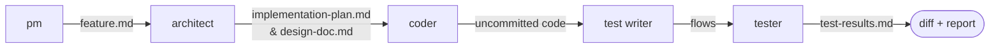

# Agentic Android Dev Team

Seven specialist AI agents that work like an Android team. You describe a
feature in your editor's chat prompt, and they pass it down the line: product
spec, implementation plan, code, then testing on a real device. What comes back
is an uncommitted diff and a test report.

Works the same way in [Claude Code](https://claude.com/claude-code),
[Antigravity](https://antigravity.google), and [OpenCode](https://opencode.ai).

## How a run works

Every run is the same chain of handoffs. Each agent reads the previous agent's
output in full before it starts, so the spec constrains the plan, the plan
constrains the code, and the plan's test cases are what actually gets tested.



You decide how much of that chain runs and who approves each step. One command
starts from a vague idea and pauses for your sign-off at every boundary, another
runs start to finish unattended, and a third puts an automated reviewer between
the phases. Two more run a single phase and stop.

Written artifacts land in a git-ignored folder for the feature. The code itself
stays uncommitted in your working tree, so you review it and commit on your own
terms. [What a run leaves behind](HOW_IT_WORKS.md#what-a-run-leaves-behind)
lists both.

## Why it is split up this way

A single agent asked to "build this feature" will plan it, write it, and grade
its own work in one pass. This project splits that job across agents with
separate mandates, and puts a reviewer between them.

* The Architect reads your codebase and writes the plan before any code exists.
  It names exact files and line numbers, and records the manual test plan up
  front.
* In guided and plan commands, what you review is a design document, not a diff.
  Deciding an approach is wrong is cheapest before the code exists, and a diff is
  the most expensive place to discover it.
* In the reviewed flow, code review always covers the final state of the tree,
  including fixes made after testing. A defect the reviewer finds gets fixed
  even when the plan never anticipated it, and anywhere a fix had to depart from
  the plan is reported back to you.
* Device tests are planned before the code and written after it. The
  Architect decides what to test; once the feature exists, the Test Writer
  turns each test case into a file that runs in seconds; the Tester judges the
  results on a real emulator, not a mocked harness. No agent grades its own
  work.
* Retry loops are bounded. Reviewers get at most two rounds, the fix loop gets at
  most two, and a run that still fails stops and explains why instead of
  reporting success.
* Nothing is committed for you.

## The agents

| Agent | Role | Output |
|---|---|---|
| `adt-android-pm` | Principal Product Manager | `feature.md`, an unambiguous spec |
| `adt-android-architect` | Staff+ Android engineer | `implementation-plan.md`, with exact file changes and a manual test plan, plus `design-doc.md` for human review |
| `adt-android-architect-reviewer` | Plan reviewer, read-only | Approval, or a numbered list of required changes |
| `adt-android-coder` | Implementer | Uncommitted code in your working tree |
| `adt-android-code-reviewer` | Code reviewer, read-only | Approval, or a numbered list of required changes |
| `adt-android-test-writer` | Test engineer | One runnable *flow* file for each test case the Architect wrote, and no tests of its own |
| `adt-android-tester` | Principal QA engineer | `test-results.md`, with a verdict from a real device |

Each agent reads your project's `AGENTS.md` (or `CLAUDE.md`) for stack,
architecture, and conventions, so the output matches your codebase rather than a
generic Android one.

## Commands

Five slash commands. Three run the full pipeline, two stop after a single phase.

| Command | Phases | Who approves | Use it for |
|---|---|---|---|
| `/build-guided` | PM, Architect, Coder, Test Writer, Tester | You, at every phase boundary | A rough idea you want shaped before code exists |
| `/build-auto` | Architect, Coder, Test Writer, Tester | Nobody, it runs start to finish | A feature you have already specified precisely |
| `/build-auto-reviewed` | Architect, Coder, Test Writer, Tester, plus a reviewer after the Architect and the Coder | Reviewer agents, with no human pause | An unattended run you want to trust. Costs more tokens |
| `/plan-research` | PM only | n/a | Turning a vague idea into a spec and nothing more |
| `/plan-design` | Architect only | n/a | Auto-detects input: produces whichever of the plan and design doc is missing |

The two single-phase commands write their artifact and stop. Their output feeds
straight into a `build-*` command later, or into each other.

### /build-guided

```
/build-guided add a recently-played carousel to the home screen
```

The PM asks clarifying questions, writes a spec, and pauses. At each boundary you
reply `approve`, `revise: <feedback>`, or `stop`. Before the Coder runs, you also
see whether the Architect judged the work parallel-safe and how many coder agents
that implies. Reply `force-sequential` to override it and spend fewer tokens.


The plan gate shows you the design doc rather than a dump of plan headings, so
the decision is made at design altitude while changing course is still cheap.
Feedback you give there is rewritten into both documents, including scope you
decline, which is recorded under **Non-Goals** with your reason rather than
dropped.

### /build-auto

```
/build-auto add a "save draft on background" hook to ComposeViewModel that
            persists the current input to Room every 2s and restores it on launch
```

No PM phase and no pauses. If the request turns out to be too vague for the
Architect to plan concretely, the run stops and points you at `/build-guided`.
This is the speed path, so it writes no design doc by default. Pass `doc: on` if
you want one.


### /build-auto-reviewed

```
/build-auto-reviewed add a "save draft on background" hook to ComposeViewModel
                     that persists input to Room every 2s and restores on launch
```

Same shape as `/build-auto`, with an automated reviewer after each producing
phase. The plan reviewer checks the plan against the codebase, Section 0 verification
tasks, and pattern-fit. The code reviewer reads the full set of changes, which includes
every new untracked file, not just what shows up in `git diff`.

When a reviewer requests changes, the producing agent re-runs with that feedback,
at most twice per gate. If the reviewer is still unsatisfied after the second
re-run, the pipeline stops and reports instead of shipping rejected work.

The code reviewer reviews the way a colleague would: a real bug is a blocker
whether or not the plan anticipated it, and the Coder is allowed to fix what it
finds even where the plan is silent. The plan is not rewritten mid-run, so on the
rare occasion a fix has to contradict it, the run summary tells you where the two
now disagree — along with the nits the reviewer raised but chose not to block on.


### /plan-research and /plan-design

```
/plan-research add a recently-played carousel to the home screen
/plan-design   pipeline_artifacts/recently-played-carousel/feature.md
/plan-design   pipeline_artifacts/recently-played-carousel/implementation-plan.md
/plan-design   pipeline_artifacts/recently-played-carousel/design-doc.md
```

/plan-research runs the PM alone. `/plan-design` runs the Architect alone. Use
them to think a feature through, or to size the work, without committing to a
build. `/plan-design` produces both of the Architect's files by default, but if
you give it an existing plan or design doc, it writes only the missing one.

`/plan-design` auto-detects what it receives. Hand it an existing
`implementation-plan.md` and it writes the design doc without re-planning. Hand
it an existing `design-doc.md` and it writes the plan without touching the doc.

### The design doc

The Architect writes `implementation-plan.md` (the build contract for agents) and
can also emit `design-doc.md` (for human review). Depending on the command used,
it produces or skips the design doc:

| Command | Design doc | Where you read it |
|---|---|---|
| `/plan-design` | auto-detected | printed to chat upon completion |
| `/build-guided` | on | at the plan approval gate, before any code is written |
| `/build-auto-reviewed` | off | not generated |
| `/build-auto` | off | not generated |

Pass `doc: on` or `doc: off` in the command arguments to override the default for a run.
Where the two documents differ, the implementation plan is the source of truth for code.

## Testing on a device

The Tester tests every feature on an Android emulator the run starts for
itself, never on yours. The Architect writes the test cases before the code;
once the code exists, the Test Writer turns them into small test files, a
script runs them, and the Tester judges the results and checks by hand what the
files cannot. Tests that pass are kept in `e2e/flows/` as a regression suite
that later features replay; commit them with the feature.

It needs a test driver, auto-mobile (the default) or Maestro, registered with
your tool. [Setting up device testing](HOW_IT_WORKS.md#setting-up-device-testing)
has the steps for Claude Code, OpenCode and Antigravity, and
[HOW_IT_WORKS.md](HOW_IT_WORKS.md#device-tests-cases-flows-and-results)
explains how the tests work.

## Requirements

* `git`
* One of [Claude Code](https://claude.com/claude-code),
  [Antigravity](https://antigravity.google), or [OpenCode](https://opencode.ai)
* An Android project with an `AGENTS.md` or `CLAUDE.md` describing its stack,
  architecture, conventions, and verification rules
* The Android SDK's emulator and platform tools (both come with Android
  Studio), and at least one AVD. See [Testing on a device](#testing-on-a-device)
* A **test driver** registered with your tool: the
  [auto-mobile](https://github.com/kaeawc/auto-mobile) MCP server (the default)
  or [Maestro](https://maestro.dev). The Tester drives the app on a device
  through it, and without it the test phase cannot run. See
  [Setting up device testing](HOW_IT_WORKS.md#setting-up-device-testing).

## Installation

There are two paths, and they are not mutually exclusive.

### Install as a Claude Code plugin

The fastest path if you only use Claude Code. From inside the CLI:

```
/plugin marketplace add jaxvy/agentic-dev-team
/plugin install agentic-dev-team@adt-pipeline
```

This installs all seven agents and all five commands with no per-project setup. It
does not wire up Antigravity or OpenCode.

### Install per project with install.sh

Use this for Antigravity and OpenCode. It also works alongside the Claude Code
plugin.

Clone the repo once, anywhere you like:

```bash
git clone https://github.com/jaxvy/agentic-dev-team.git ~/code/agentic-dev-team
```

Then run the installer from each Android project root:

```bash
cd /path/to/your-android-project
~/code/agentic-dev-team/install.sh
```

It links the agents and commands into the project's `.claude/`,
`.agents/workflows/`, and `.opencode/`. Your existing content in those
directories is never touched, modified, or migrated, with one deliberate
exception: it adds the pipeline's three permission rules to
`.claude/settings.local.json`, keeping every setting already there, so a run
does not stop to ask (see
[Permissions](HOW_IT_WORKS.md#before-a-run-preflight-and-permissions)). Pass
`--no-allow` to skip that.

### Updating

```bash
cd ~/code/agentic-dev-team && git pull && cd /path/to/your-project
~/code/agentic-dev-team/install.sh
```

`git pull` refreshes edits to existing agents and commands, and those take effect
immediately because your project links to them. Re-running `install.sh` is what
picks up newly added files and clears out removed ones. It is a sync rather than
an append.

### Uninstalling

```bash
~/code/agentic-dev-team/install.sh --uninstall
```

This removes only what it created: its own symlinks, its marker-fenced blocks
in `.gitignore` and `.agents/agents.md`, and the permission rules it added to
`.claude/settings.local.json`. Your files and the clone are left alone.

## Further reading

[HOW_IT_WORKS.md](HOW_IT_WORKS.md) covers the pipeline phase by phase, its
[safeguards](HOW_IT_WORKS.md#safeguards), how the three tools discover the same files, everything
`install.sh` creates, how to add your own agents and commands, and
troubleshooting.

## Built with this pipeline

This project was used to build
[MaybeLater](https://play.google.com/store/apps/details?id=com.jaxvy.maybelater),
a shipped Android app, as a way to validate that the pipeline holds up on real
work rather than on examples written for a README. You can find the app at
[getmaybelater.app](https://getmaybelater.app) or on
[Google Play](https://play.google.com/store/apps/details?id=com.jaxvy.maybelater).

## License

See [LICENSE](LICENSE).
