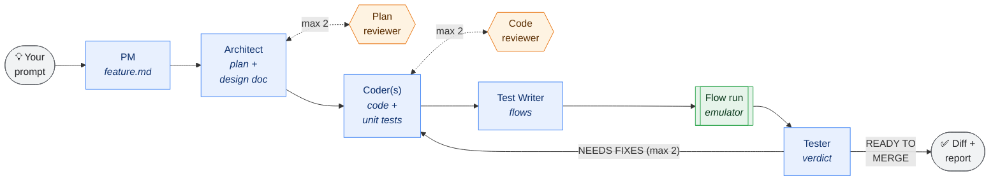
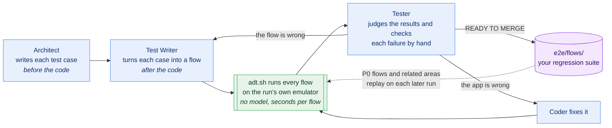
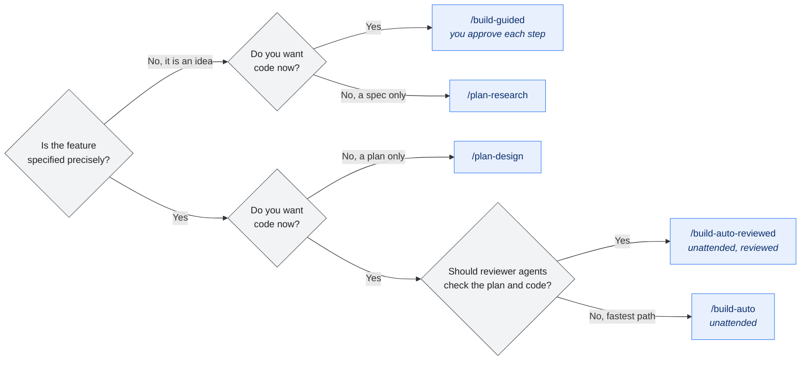

<h1 align="center">Agentic Android Dev Team</h1>

<p align="center">
  <b>Describe an Android feature in one prompt. Get back a planned, reviewed, device-tested diff.</b>
</p>

<p align="center">
  <a href="LICENSE"></a>
  
  
  
  
</p>

<p align="center">
  <a href="#quick-start">Quick start</a> ·
  <a href="#what-you-get">What you get</a> ·
  <a href="#how-a-run-works">How a run works</a> ·
  <a href="#pick-a-command">Commands</a> ·
  <a href="HOW_IT_WORKS.md">How it works</a>
</p>

Eight specialist AI agents work like a real Android team: a product manager, an
architect, coders, reviewers, a test writer and a QA engineer. You type one
command in your editor's chat. They write the spec, plan the change against your
real codebase, write the code and its unit tests, review it, and test it on an
Android emulator they boot for themselves. You get an uncommitted diff, a test
report, and new regression tests for your project.

```text
/build-auto-reviewed add a "save draft on background" hook to ComposeViewModel
                     that persists input to Room every 2s and restores on launch
```

> [!NOTE]
> **Proven on a shipped app.** This pipeline was used to build
> [MaybeLater](https://play.google.com/store/apps/details?id=com.jaxvy.maybelater),
> an Android app live on Google Play, to prove that it holds up on real work.

## What you get

| Capability | What it does for you |
|---|---|
| 📱 **Tested on a real emulator, not a mock** | Each run boots a headless copy of your AVD while the code is being written. Every test case becomes a flow file that runs in seconds with no model in the loop. A crash or ANR fails the test, even when every check passed. |
| 🧪 **A regression suite that grows with each feature** | Flows that pass are saved to `e2e/flows/` with a P0, P1 or P2 priority. Later runs replay them, so a new feature cannot quietly break an old one. |
| 📐 **A plan before any code** | The Architect reads your codebase first. The plan names exact files and line numbers, your real Gradle commands, the `testTag` of each UI element, and each unit test as GIVEN / WHEN / THEN. |
| 📝 **A design doc you can approve** | You review the approach in plain prose, with a diagram and the alternatives it rejected. A wrong design is cheap to fix before the code exists. |
| 🔍 **No agent grades its own work** | Separate reviewers check the plan and the code. A real bug blocks the run, even when the plan did not expect it. You can make a review gate a panel of 2 to 5 reviewers on different models: Claude, Codex, Gemini and more. |
| 🧩 **It follows your conventions** | Each agent reads your `AGENTS.md` or `CLAUDE.md`, uses the skills your project has, and uses the test libraries in your version catalog. The output looks like your codebase, not a generic sample. |
| ⚡ **Parallel coders, checked first** | When the plan is parallel-safe, several coders work at the same time. Before they start, a script confirms that no two of them edit the same file. |
| 🛡️ **Safe by default** | Nothing is committed for you. Retries are limited. A test that could not run never counts as a pass. The installer never overwrites your files. |

## Quick start

**1. Install** (Claude Code; for Antigravity and OpenCode, see [Installation](#installation)):

```text
/plugin marketplace add jaxvy/agentic-dev-team
/plugin install agentic-dev-team@adt-pipeline
```

**2. Register a test driver.** The agents drive your app through
[auto-mobile](https://github.com/kaeawc/auto-mobile) (the default) or
[Maestro](https://maestro.dev):

```bash
claude mcp add auto-mobile -e AUTOMOBILE_ENABLED_TOOLS=rotate,displayConfig,setAppPermissions,setDeviceState,getDeviceState,openLink,executePlan -- bunx @kaeawc/auto-mobile@0.0.84
```

**3. Describe your project** in an `AGENTS.md` or `CLAUDE.md` at its root: the
stack, the architecture, the conventions, and how to verify a change.

**4. Build a feature:**

```text
/build-guided add a recently-played carousel to the home screen
```

Every build command checks your setup first, and if something is missing, it
stops and tells you how to fix it. The full checklist is in
[Requirements](#requirements).

## How a run works

Each agent reads the previous agent's output in full before it starts. The spec
constrains the plan, the plan constrains the code, and the test cases in the
plan are what gets tested on the device.



* **Blue** agents produce work. **Orange** reviewers are read-only: they
  approve, or they send back a numbered list of changes. The **green** step is
  a script, not a model.
* The PM runs only in `/build-guided` and `/plan-research`. The reviewers run
  only in `/build-auto-reviewed`. In `/build-guided`, you approve each step
  yourself.
* Each loop has a limit, counted by a script. When work is still rejected
  after the last round, the run stops and tells you why. It does not report a
  success. A run whose session died continues with
  `/build-auto resume <slug>` (or the command it started with).

### Testing on a device

Each test is written once, by one agent, at the time it can be written well.



* **Your emulator stays free.** Each run boots a read-only copy of your AVD.
  Two features in two git worktrees can be tested at the same time.
* **The plan's selectors are requirements.** If the Coder leaves out a
  `testTag`, the flow fails there. It does not quietly find the button by its
  label.
* **The report says how sure it is.** `test-results.md` starts with
  "Verified V of N plan cases" and lists each case that was not verified, with
  the reason.
* **It asks when it is blocked.** On a locked screen or a sign-in, the Tester
  stops and asks you for the one thing it needs, for example the device PIN.
  It never writes the value down.
* **Flows can sign in.** Name your test account's secrets in `AGENTS.md` and
  put the values in the git-ignored `.agentic-dev-team/secrets.env`. The script
  fills them in when a flow runs and removes them from every log
  ([Test secrets and test hooks](HOW_IT_WORKS.md#test-secrets-and-test-hooks)).
* **The suite runs without the agents too.** `adt.sh suite` replays
  `e2e/flows/` on a device that is already running, with no model, and writes
  a JUnit report, so a CI machine with an emulator can run it on every pull
  request.

## Pick a command



| Command | PM | Architect | Plan review | Coder | Code review | Device test | Who approves |
|---|:--:|:--:|:--:|:--:|:--:|:--:|---|
| `/build-guided` | ✅ | ✅ | | ✅ | | ✅ | You, at each step |
| `/build-auto` | | ✅ | | ✅ | | ✅ | Nobody: it runs from start to finish |
| `/build-auto-reviewed` | | ✅ | ✅ | ✅ | ✅ | ✅ | Reviewer agents. Uses more tokens |
| `/plan-research` | ✅ | | | | | | Stops after the spec |
| `/plan-design` | | ✅ | | | | | Stops after the plan and design doc |

<details>
<summary><b>/build-guided</b>: from a rough idea, with your approval at each step</summary>

```text
/build-guided add a recently-played carousel to the home screen
```

The PM asks clarifying questions, writes a spec, and pauses. At each step you
reply `approve`, `revise: <feedback>`, or `stop`.

At the plan step you read the design doc, not a list of plan headings, so you
decide on the design while a change is still cheap. Your feedback goes into
both documents. Scope that you decline is recorded under **Non-Goals** with
your reason.

Before the Coder starts, you also see whether the Architect made the work
parallel-safe and how many coders that means. Reply `force-sequential` to use
one coder and fewer tokens.

</details>

<details>
<summary><b>/build-auto</b>: the fastest path, for a feature you already specified</summary>

```text
/build-auto add a "save draft on background" hook to ComposeViewModel that
            persists the current input to Room every 2s and restores it on launch
```

No PM and no pauses. If the request is too vague to plan, the run stops and
tells you to use `/build-guided`. It writes no design doc by default. Pass
`doc: on` to get one.

</details>

<details>
<summary><b>/build-auto-reviewed</b>: unattended, with a reviewer after the plan and after the code</summary>

```text
/build-auto-reviewed add a "save draft on background" hook to ComposeViewModel
                     that persists input to Room every 2s and restores on launch
```

The same as `/build-auto`, with a reviewer after the Architect and after the
Coder. The plan reviewer checks the plan against your codebase. The code
reviewer reads every changed file, including new files that `git diff` does
not show.

When a reviewer asks for changes, the agent does the work again with that
feedback, at most twice for each review. A real bug blocks the run even when
the plan did not expect it, and the Coder can fix it. If a fix has to go
against the plan, the run summary tells you where.

When the Tester's findings make the Coder change the code, the code reviewer
checks that change before the next test. The code you get passed review after
its last change.

Each review has one reviewer unless you configure a panel of 2 to 5. See
[Configuration](#configuration).

</details>

<details>
<summary><b>/plan-research</b> and <b>/plan-design</b>: plan only, no code</summary>

```text
/plan-research add a recently-played carousel to the home screen
/plan-design   pipeline_artifacts/recently-played-carousel/feature.md
/plan-design   pipeline_artifacts/recently-played-carousel/implementation-plan.md
/plan-design   pipeline_artifacts/recently-played-carousel/design-doc.md
```

`/plan-research` runs only the PM. `/plan-design` runs only the Architect. Use
them to think a feature through, or to estimate the work, before you build it.
Their output goes directly into a `build-*` command later: pass the file's path
(`/build-auto pipeline_artifacts/<slug>/implementation-plan.md`), and the build
command skips the phases that file already covers.

`/plan-design` finds out what you gave it. From a spec or an idea, it writes the
plan and the design doc. From an existing plan, it writes only the design doc.
From an existing design doc, it writes only the plan.

</details>

### The design doc

The Architect writes two documents. `implementation-plan.md` is the build
contract for the agents. `design-doc.md` is for you: prose, a diagram, the
alternatives that lost, the blast radius, and how to roll back.

| Command | Design doc | Where you read it |
|---|---|---|
| `/build-guided` | on | At the plan step, before any code is written |
| `/plan-design` | finds out what is missing | In the chat, when it is done |
| `/build-auto` | off | Not written |
| `/build-auto-reviewed` | off | Not written |

Pass `doc: on` or `doc: off` to change this for one run. When the two documents
differ, the plan is the source of truth for the code.

## What a run leaves behind

```text
your-android-project/
├── app/ ...                    # your code, with the changes uncommitted
├── e2e/flows/                  # the regression suite: commit it with the feature
└── pipeline_artifacts/         # git-ignored
    └── recently-played-carousel/
        ├── feature.md              # the spec (only when the PM ran)
        ├── implementation-plan.md  # the plan, with the manual test plan
        ├── design-doc.md           # the same design, written for you
        ├── flows/                  # one flow per test case, and INDEX.md
        ├── run-results.md          # each flow's result and time
        ├── run-logs/               # the test driver's output for each flow
        └── test-results.md         # per-case results, verdict, observations
```

Nothing is committed for you. Review the diff, stage what you want, and commit
when you are ready.

## The agents

| Agent | Role | Output |
|---|---|---|
| `adt-android-pm` | Principal product manager | `feature.md`, a clear spec |
| `adt-android-architect` | Staff+ Android engineer | `implementation-plan.md` with exact file changes and a manual test plan, and `design-doc.md` for you |
| `adt-android-architect-reviewer` | Plan reviewer, read-only | Approval, or a numbered list of changes |
| `adt-android-coder` | Implementer | Uncommitted code and the unit tests the plan names |
| `adt-android-code-reviewer` | Code reviewer, read-only | Approval, or a numbered list of changes |
| `adt-android-test-writer` | Test engineer | One flow file for each test case the Architect wrote, and no tests of its own |
| `adt-android-tester` | Principal QA engineer | `test-results.md`, with a verdict from a real device |
| `adt-android-review-judge` | Panel judge, read-only. Runs only with a review panel | The verified, merged findings of the panel, and the verdict |

## Requirements

* macOS or Linux. The scripts are bash and use Unix process tools, so Windows
  is not supported.
* `git`
* [Claude Code](https://claude.com/claude-code),
  [Antigravity](https://antigravity.google), or [OpenCode](https://opencode.ai)
* An Android project with an `AGENTS.md` or `CLAUDE.md` that describes its stack,
  architecture, conventions, and verification rules
* The Android SDK emulator and platform tools (they come with Android Studio),
  and at least one AVD
* A test driver registered with your tool:
  [auto-mobile](https://github.com/kaeawc/auto-mobile) (the default) or
  [Maestro](https://maestro.dev). A Maestro project also needs the line
  `Test driver: maestro` in its `AGENTS.md` or `CLAUDE.md`.
  [Setting up device testing](HOW_IT_WORKS.md#setting-up-device-testing) has
  the steps for each tool.

## Installation

There are two paths. You can use both.

### Claude Code plugin

The fastest path if you use only Claude Code. In the CLI:

```text
/plugin marketplace add jaxvy/agentic-dev-team
/plugin install agentic-dev-team@adt-pipeline
```

This installs all eight agents and five commands, with no setup for each
project. It does not set up Antigravity or OpenCode. The first command you run
in a project creates the optional config file. Claude Code asks your
permission for that one command.

### install.sh, for each project

Use this for Antigravity and OpenCode. It also works together with the Claude
Code plugin.

```bash
git clone https://github.com/jaxvy/agentic-dev-team.git ~/code/agentic-dev-team
cd /path/to/your-android-project
~/code/agentic-dev-team/install.sh
```

It links the agents, commands and scripts into `.claude/`,
`.agents/workflows/` and `.opencode/`, and creates the optional config file
`.agentic-dev-team/config.yaml`. It does not change your files in those
directories, with one exception: it adds the pipeline's three permission rules
to `.claude/settings.local.json` and keeps all your other settings, so a run
does not stop to ask (see
[Permissions](HOW_IT_WORKS.md#before-a-run-preflight-and-permissions)). Pass
`--no-allow` to skip this.

<details>
<summary><b>Update and uninstall</b></summary>

To update:

```bash
cd ~/code/agentic-dev-team && git pull && cd /path/to/your-project
~/code/agentic-dev-team/install.sh
```

`git pull` updates the agents and commands you have. The changes apply
immediately, because your project links to them. Run `install.sh` again to add
new files and remove old ones.

To uninstall:

```bash
~/code/agentic-dev-team/install.sh --uninstall
```

This removes only what the installer created: its symlinks, its marked blocks
in `.gitignore` and `.agents/agents.md`, and the permission rules it added to
`.claude/settings.local.json`. It keeps `.agentic-dev-team/`, because that is
your configuration. Delete it yourself if you do not need it. Uninstalling the
Claude Code plugin does not change your project, so delete that folder
yourself there too.

</details>

## Configuration

All settings are optional. Until you edit `.agentic-dev-team/config.yaml`,
every command works as it does without the file. The file is created with every
setting commented out, and it is kept out of git.

* **`agents:`** sets the model of each agent, in every command. Only Claude Code
  uses it. Antigravity and OpenCode run every agent on the model you select in
  the tool.
* **`build_auto_reviewed:`** applies only to `/build-auto-reviewed`. An agent can
  run through another CLI you are logged in to (`claude`, `codex`, `agy`,
  `opencode`, or your own command). A review with 2 to 5 reviewers becomes a
  panel: they review the same work in parallel, and when one of them asks for
  changes, a judge agent checks each finding against the code.

```yaml
agents:
  coder: { model: opus }
build_auto_reviewed:
  code_reviewer:
    reviewers:
      - { runner: native }
      - { runner: codex, required: false }
```

Each panel round costs one agent run for each reviewer, plus one for the judge.
[HOW_IT_WORKS.md](HOW_IT_WORKS.md#configuration) has every setting, the
runners, how a panel runs, and what to know before you use another CLI.

## Further reading

[HOW_IT_WORKS.md](HOW_IT_WORKS.md) explains each phase of the pipeline, its
[safeguards](HOW_IT_WORKS.md#safeguards), the emulator settings, how the three
tools find the same files, what `install.sh` creates, how to add your own agents
and commands, and troubleshooting.

## License

MIT. See [LICENSE](LICENSE).
