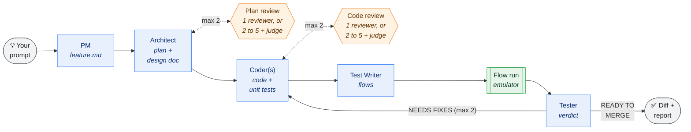
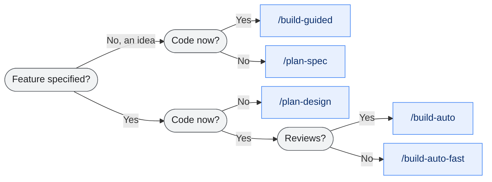

<h1 align="center">Agentic Android Dev Team</h1>

<p align="center">
  <b>A team of AI agents that plans, codes, reviews and tests Android features on an emulator.</b><br>
  It works in your own codebase, from the coding tool you already use. You give it a feature
  request and get back a reviewed, emulator-tested diff.
</p>

<p align="center">
  <a href="LICENSE"></a>
  
  
  
  
  
</p>

<p align="center">
  <a href="#quick-start">Quick start</a> ·
  <a href="#what-you-get">What you get</a> ·
  <a href="#the-pipeline">The pipeline</a> ·
  <a href="HOW_IT_WORKS.md">How it works</a>
</p>

Eight specialist AI agents work like a real Android team: a product manager, an
architect, coders, reviewers, a test writer and a QA engineer. You type one
command in your editor's chat. They write the spec, plan the change against your
real codebase, write the code and its unit tests, review it, and test it on an
Android emulator they boot for themselves. You get an uncommitted diff, a test
report, and new regression tests for your project.

```text
/build-auto add a "save draft on background" hook to ComposeViewModel
                     that persists input to Room every 2s and restores on launch
```

> [!NOTE]
> **Proven on a shipped app.** This pipeline was used to build
> [MaybeLater](https://play.google.com/store/apps/details?id=com.jaxvy.maybelater),
> an Android app live on Google Play, to prove that it holds up on real work.

## What you get

| Capability | What it does for you |
|---|---|
| 📱 **Tested on a real emulator, not a mock** | Each run boots a headless copy of your AVD while the code is being written. Every test case becomes a flow file that runs in seconds with no model in the loop. A crash or ANR fails the test, even when every check passed. |
| 🧪 **A regression suite that grows with each feature** | Flows that pass are saved to `e2e/flows/` with a P0, P1 or P2 priority. Later runs replay them, so a new feature cannot quietly break an old one. |
| 📐 **A plan before any code** | The Architect reads your codebase first. The plan names exact files and line numbers, your real Gradle commands, the `testTag` of each UI element, and each unit test as GIVEN / WHEN / THEN. |
| 📝 **A design doc you can approve** | You review the approach in plain prose, with a diagram and the alternatives it rejected. A wrong design is cheap to fix before the code exists. |
| 🔍 **No agent grades its own work** | Separate reviewers check the plan and the code. A real bug blocks the run, even when the plan did not expect it. You can make a review gate a panel of 2 to 5 reviewers on different models: Claude, Codex, Gemini and more. |
| 🧩 **It follows your conventions** | Each agent reads your `AGENTS.md` or `CLAUDE.md`, uses the skills your project has, and uses the test libraries in your version catalog. The output looks like your codebase, not a generic sample. |
| ⚡ **Parallel coders, checked first** | When the plan is parallel-safe, several coders work at the same time. Before they start, a script confirms that no two of them edit the same file. |
| 🛡️ **Safe by default** | Nothing is committed for you. Retries are limited. A test that could not run never counts as a pass. The installer never overwrites your files. |

## The pipeline

### How a run works

Each agent works from what the agent before it wrote: the Architect plans from
the spec, the Coders build what the plan says, and the Tester checks the app
against the test cases in the plan
([Device tests](HOW_IT_WORKS.md#device-tests-cases-flows-and-results)).



The diagram shows every step a build can take. **Blue** agents produce work,
**orange** reviewers are read-only, and the **green** step is a script, not a
model. Each command runs part of it:

| Command | PM | Architect | Plan review | Coder | Code review | Device test | Who approves |
|---|:--:|:--:|:--:|:--:|:--:|:--:|---|
| `/build-guided` | ✅ | ✅ | | ✅ | | ✅ | You, at each step |
| `/build-auto-fast` | | ✅ | | ✅ | | ✅ | Nobody: it runs from start to finish |
| `/build-auto` | | ✅ | ✅ | ✅ | ✅ | ✅ | Reviewer agents. Uses more tokens |
| `/plan-spec` | ✅ | | | | | | Stops after the spec |
| `/plan-design` | | ✅ | | | | | Stops after the plan and design doc |

* **`/build-guided`**, for a rough idea. The PM asks clarifying questions and
  writes a spec. There are no reviewer agents: the run stops after the spec,
  the plan, the code and the test results, and you reply `approve`,
  `revise: <feedback>`, or `stop`. At the plan step you read the design doc,
  so you decide on the design while a change is still cheap. Scope you decline
  is recorded under **Non-Goals** with your reason. Before the Coder starts,
  you see how many coders the plan allows. Reply `force-sequential` to use one
  coder and fewer tokens.
* **`/build-auto-fast`**, the fastest path for a feature you already
  specified. It runs the Architect, the Coder and the test steps, with no
  reviews and no stops. If the request is too vague to plan, the run stops and
  tells you to use `/build-guided`.
* **`/build-auto`**, the same as `/build-auto-fast` with two reviews. The plan
  review checks the plan against your codebase. The code review reads every
  changed file, including new files that `git diff` does not show. A reviewer
  approves, or sends the work back with a numbered list of changes, at most
  twice for each review. A real bug blocks the run even when the plan did not
  expect it, and the Coder can fix it. If a fix has to go against the plan, the
  run summary tells you where. When the Tester's findings make the Coder change
  the code, the code review checks that change before the next test. A review
  has one reviewer unless you set up a panel of 2 to 5, whose findings a judge
  agent checks ([Configuration](#configuration)). It uses more tokens.
* **`/plan-spec`** and **`/plan-design`**, to think a feature through or
  estimate it before you build. `/plan-spec` runs only the PM. `/plan-design`
  runs only the Architect and writes what is missing: from a spec or an idea,
  the plan and the design doc; from a plan, the design doc; from a design doc,
  the plan. Pass the file either one writes to a build command, which skips the
  phases that file covers. `/plan-spec` followed by `/build-auto` runs every
  step in the diagram.

  ```text
  /plan-spec    add a recently-played carousel to the home screen
  /plan-design  pipeline_artifacts/recently-played-carousel/feature.md
  /build-auto   pipeline_artifacts/recently-played-carousel/implementation-plan.md
  ```

Each loop has a limit, counted by a script. When work is still rejected after
the last round, the run stops and tells you why. It does not report a success.
A run whose session died continues with `/build-auto-fast resume <slug>` (or
the command it started with).

To choose a command:



#### The design doc

The Architect writes two documents. `implementation-plan.md` is the build
contract for the agents. `design-doc.md` is for you: prose, a diagram, the
alternatives that lost, the blast radius, and how to roll back.

| Command | Design doc | Where you read it |
|---|---|---|
| `/build-guided` | on | At the plan step, before any code is written |
| `/plan-design` | finds out what is missing | In the chat, when it is done |
| `/build-auto-fast` | off | Not written |
| `/build-auto` | off | Not written |

Pass `doc: on` or `doc: off` to change this for one run. When the two documents
differ, the plan is the source of truth for the code.

### The agents

| Agent | Role | Output |
|---|---|---|
| `adt-android-pm` | Principal product manager | `feature.md`, a clear spec |
| `adt-android-architect` | Staff+ Android engineer | `implementation-plan.md` with exact file changes and a manual test plan, and `design-doc.md` for you |
| `adt-android-architect-reviewer` | Plan reviewer, read-only | Approval, or a numbered list of changes |
| `adt-android-coder` | Implementer | Uncommitted code and the unit tests the plan names |
| `adt-android-code-reviewer` | Code reviewer, read-only | Approval, or a numbered list of changes |
| `adt-android-test-writer` | Test engineer | One flow file for each test case the Architect wrote, and no tests of its own |
| `adt-android-tester` | Principal QA engineer | `test-results.md`, with a verdict from a real device |
| `adt-android-review-judge` | Panel judge, read-only. Runs only with a review panel | The verified, merged findings of the panel, and the verdict |

### What a run leaves behind

```text
your-android-project/
├── app/ ...                    # your code, with the changes uncommitted
├── e2e/flows/                  # the regression suite: commit it with the feature
└── pipeline_artifacts/         # git-ignored
    └── recently-played-carousel/
        ├── feature.md              # the spec (only when the PM ran)
        ├── implementation-plan.md  # the plan, with the manual test plan
        ├── design-doc.md           # the same design, written for you
        ├── flows/                  # one flow per test case, and INDEX.md
        ├── run-results.md          # each flow's result and time
        ├── run-logs/               # the test driver's output for each flow
        └── test-results.md         # per-case results, verdict, observations
```

Nothing is committed for you. Review the diff, stage what you want, and commit
when you are ready.

## Quick start

**1. Install.** In Claude Code:

```text
/plugin marketplace add jaxvy/agentic-dev-team
/plugin install agentic-dev-team@adt-pipeline
```

In Codex, add the marketplace, then install `agentic-dev-team` from
`/plugins` in a new session. For Antigravity and OpenCode, see
[Installation](#installation).

```bash
codex plugin marketplace add jaxvy/agentic-dev-team
```

**2. Register a test driver.** The agents drive your app through
[auto-mobile](https://github.com/kaeawc/auto-mobile) (the default) or
[Maestro](https://maestro.dev):

```bash
claude mcp add auto-mobile -e AUTOMOBILE_ENABLED_TOOLS=rotate,displayConfig,setAppPermissions,setDeviceState,getDeviceState,openLink,executePlan -- bunx @kaeawc/auto-mobile@0.0.84
```

In Codex, use `codex mcp add` with the same name, `--env` and command
([Setting up device testing](HOW_IT_WORKS.md#setting-up-device-testing)).

**3. Describe your project (optional).** The agents follow the `AGENTS.md` or
`CLAUDE.md` at your project's root when it has one: the stack, the
architecture, the conventions, and how to verify a change.

**4. Build a feature:**

```text
/build-guided add a recently-played carousel to the home screen
```

In Codex, the commands are skills: type `$build-guided` and the rest of the
line. Give Codex the access the run needs first
([Codex](HOW_IT_WORKS.md#codex)).

Every build command checks your setup first, and if something is missing, it
stops and tells you how to fix it. The full checklist is in
[Requirements](#requirements).

## Installation

There are two paths: a plugin, for Claude Code or Codex, and `install.sh`,
for each project and every tool. You can use both. Both need the
requirements below.

### Requirements

* macOS or Linux. The scripts are bash and use Unix process tools, so Windows
  is not supported.
* `git`, with your project in a git repository. The agents leave their
  changes uncommitted, and the coders and the code review find them with git.
  The `install.sh` path also uses `git clone`.
* [Claude Code](https://claude.com/claude-code),
  [Codex](https://developers.openai.com/codex),
  [Antigravity](https://antigravity.google), or [OpenCode](https://opencode.ai)
* The Android SDK emulator and platform tools (they come with Android Studio),
  and at least one AVD
* A test driver registered with your tool:
  [auto-mobile](https://github.com/kaeawc/auto-mobile) (the default) or
  [Maestro](https://maestro.dev). A Maestro project also needs the line
  `Test driver: maestro` in its `AGENTS.md` or `CLAUDE.md`.
  [Setting up device testing](HOW_IT_WORKS.md#setting-up-device-testing) has
  the steps for each tool.

### Claude Code plugin

The fastest path if you use Claude Code. In the CLI:

```text
/plugin marketplace add jaxvy/agentic-dev-team
/plugin install agentic-dev-team@adt-pipeline
```

This installs all eight agents and five commands, with no setup for each
project. It does not set up the other tools. The first command you run in a
project creates the optional config file. Claude Code asks your permission for
that one command.

### Codex plugin

The fastest path if you use Codex. Add the marketplace:

```bash
codex plugin marketplace add jaxvy/agentic-dev-team
```

Then start `codex`, open `/plugins`, install `agentic-dev-team` from the
`adt-pipeline` marketplace, and start a new session. The five commands are
skills: `$agentic-dev-team:build-auto-fast` and so on (type `$` to pick one). The
plugin has no agent files, because a Codex plugin cannot carry them: the
commands start Codex's default agent with each role's prompt. `install.sh`
adds named agents. Before the first build, in each project, approve the device
script for Codex once; the preflight prints the exact command, and
[Codex](HOW_IT_WORKS.md#codex) explains it.

### install.sh, for each project

Use this for Antigravity and OpenCode, and for Codex when you want its named
agents. It also works together with either plugin: with a plugin, install only
the other tools, for example `install.sh opencode`.

```bash
git clone https://github.com/jaxvy/agentic-dev-team.git ~/code/agentic-dev-team
cd /path/to/your-android-project
~/code/agentic-dev-team/install.sh                   # all four tools
~/code/agentic-dev-team/install.sh claude            # only Claude Code
~/code/agentic-dev-team/install.sh claude,codex      # Claude Code and Codex
```

The tools are `claude`, `codex`, `antigravity` and `opencode`. With no tool,
it installs for all four. Every tool gets the agent prompts, the pipeline docs
and the scripts in `.claude/`, because every tool reads them there. Each tool
also gets its own files: `.claude/commands/` for Claude Code;
`.claude/commands/`, `.agents/skills/` and `.codex/agents/` for Codex;
`.agents/workflows/` for Antigravity; and `.opencode/` for OpenCode.

It also creates the optional config file `.agentic-dev-team/config.yaml`. It
does not change your files in those directories, with one exception: for
Claude Code, it adds the pipeline's three permission rules to
`.claude/settings.local.json` and keeps all your other settings. For Codex, it
writes its own rules file, `.codex/rules/agentic-dev-team.rules`. With these, a
run does not stop to ask (see
[Permissions](HOW_IT_WORKS.md#before-a-run-preflight-and-permissions)). Pass
`--no-allow` to skip both.

<details>
<summary><b>Update and uninstall</b></summary>

To update:

```bash
cd ~/code/agentic-dev-team && git pull && cd /path/to/your-project
~/code/agentic-dev-team/install.sh claude   # the same tools as before
```

`git pull` updates the agents and commands you have. The changes apply
immediately, because your project links to them. Run `install.sh` again to add
new files and remove old ones. Give it the same tools as before: each run
installs exactly the tools it names and removes the links of the others.

To uninstall:

```bash
~/code/agentic-dev-team/install.sh --uninstall
```

This removes only what the installer created: its symlinks, its marked blocks
in `.gitignore` and `.agents/agents.md`, the permission rules it added to
`.claude/settings.local.json`, and its Codex rules file. It keeps
`.agentic-dev-team/`, because that is your configuration. Delete it yourself if
you do not need it. Uninstalling the Claude Code or Codex plugin does not
change your project, so delete that folder yourself there too.

</details>

## Configuration

All settings are optional. Until you edit `.agentic-dev-team/config.yaml`,
every command works as it does without the file. The file is created with every
setting commented out, and it is kept out of git.

* **`agents:`** sets the model of each agent, in every command. Claude Code and
  Codex use it, each with its own model names. Antigravity and OpenCode run
  every agent on the model you select in the tool.
* **`build_auto:`** applies only to `/build-auto`. An agent can
  run through another CLI you are logged in to (`claude`, `codex`, `agy`,
  `opencode`, or your own command). A review with 2 to 5 reviewers becomes a
  panel: they review the same work in parallel, and when one of them asks for
  changes, a judge agent checks each finding against the code.

In this example, your current tool and Antigravity both review the plan, and
your current tool and Codex both review the code. A review you leave out has
one reviewer in your current tool.

```yaml
agents:
  coder: { model: opus }
build_auto:
  architect_reviewer:
    reviewers:
      - { runner: native }
      - { runner: agy, model: argon }
  code_reviewer:
    reviewers:
      - { runner: native }
      - { runner: codex, required: false }
```

Each panel round costs one agent run for each reviewer, plus one for the judge.
[HOW_IT_WORKS.md](HOW_IT_WORKS.md#configuration) has every setting, the
runners, how a panel runs, and what to know before you use another CLI.

## Further reading

[HOW_IT_WORKS.md](HOW_IT_WORKS.md) explains each phase of the pipeline, its
[safeguards](HOW_IT_WORKS.md#safeguards), the emulator settings, how the four
tools find the same files, what `install.sh` creates, how to add your own agents
and commands, and troubleshooting.

## License

MIT. See [LICENSE](LICENSE).
